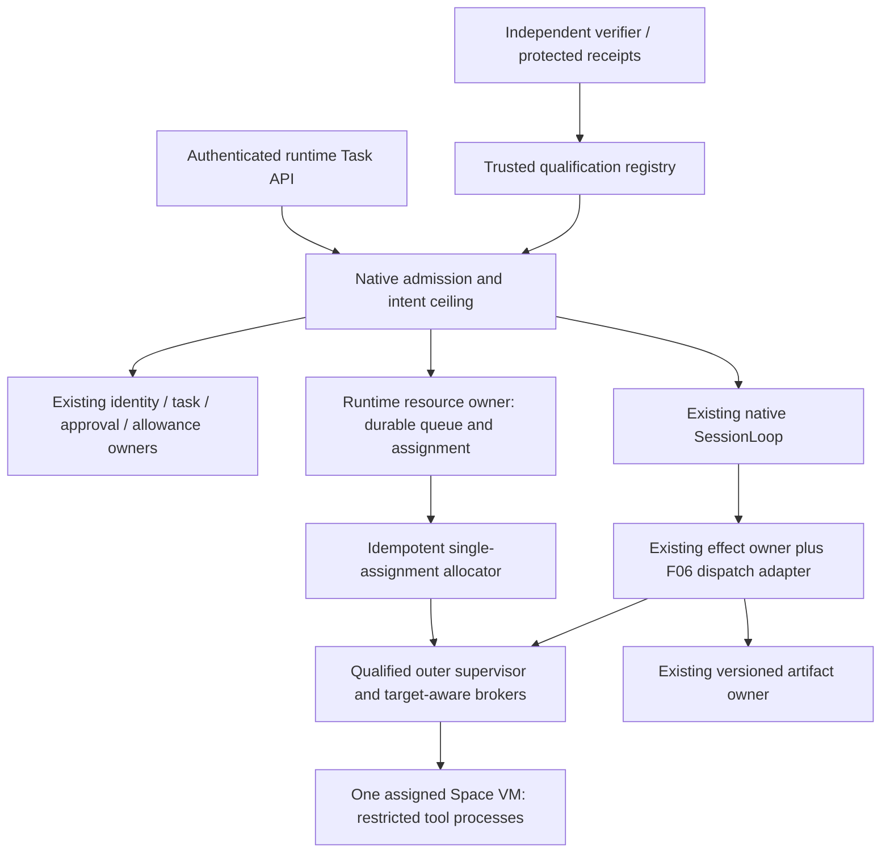

# G1-F06 solution: protected runtime and explicit contention

Date: 2026-10-16. Stage: solution. Role: architect. Status: turn 16 revision after PR-F06-04 and PR-F06-05, retaining PR-F06-01/02/03 corrections; submitted for renewed test design, planning, resources and independent review. No runtime implementation or deployment qualification is claimed. The turn 13 plan/task snapshot and turn 14 readiness remain rejected execution baselines until their assigned stages regenerate them against §§5.1–5.3 below.

## 1. Context, source baseline and decisions

This design implements the [F06 brief](product-brief.md) and the controller's 101 finalized requirements (98 Must, 2 Should, 1 Could). The governing sources are the [roadmap](../../planning/roadmap.md), [foundation sequence](../../planning/g1-foundations-plan.md), [remaining ledger](../../planning/g1-remaining-ledger.csv), master specification §§2, 5–14, 21, 25–32, and [F02 evidence](../../evidence/g1-f02-acceptance.md). AF-13, UX-03, UX-07 and UX-10 remain obligations for actual environments, not merely broker predicates.

Decisions within existing scope:

1. Add `g1-runtime/` as another strict TypeScript ESM package. Keep one native kernel and existing record owners. Add runtime resources and enforcement integration; do not introduce another planner, identity system, effect ledger or allowance ledger.
2. Separate a Docker-free `owned-local-fixture-v1` test composition from a deployment profile. It exercises actual requests, child processes, resource-owner effects, durable queues and recovery. It does not expose arbitrary executable plugins or claim a macOS security sandbox. Unsupported execution and sensitive authentication refuse before launch/login.
3. Target an explicitly configured OpenShell MicroVM adapter on approved Linux/KVM infrastructure for remote qualification. Pin and test the exact release, host, image and controls before activation. This is a backend design choice, not permission to install, boot, deploy or change security settings. No Docker, Podman, Kubernetes or runtime autodetection fallback is permitted.
4. Keep one assigned Space guest VM. Use a conservative whole-computer mutation lease initially. Resource-specific conflicts are reported, but all mutable computer work serializes unless independent enforcement proves disjointness. Never create a VM per task to resolve a conflict.
5. Initial sensitive-login and graphical-input capabilities are unsupported. Implement and verify their refusal and stale-grant behavior. Real browser profile/cookie/input/telemetry isolation remains an explicit external obligation. Future activation requires its own exact tested capability rows, not a profile-directory flag.

Remote request **q-a1b6151885** was answered by the human at 2026-10-15T16:37:20Z: **“Keep remote testing unapproved; continue local work only.”** The controller records `approved:false`. Do not duplicate the request or perform remote work; later remote activation requires a new explicit human authorization with limits. This answer arrived during solution drafting and was confirmed from the controller at submission. The temporary no-Docker/no-container decision applies to proposed checks and their transitive helpers. No environment action, production code, freeze or re-freeze occurs in this stage. Broad standing approval covers these design choices; it does not cover reserved operations.

## 2. Existing structure and dependency constraints

The repository uses independently pinned increment packages, TypeScript 5.9.3, Node 22.22.3, pnpm 10.18.0, `.js` ESM imports, closed runtime decoders, native Node tests and builds under `node_modules/.cache/`. Existing source and evidence guards are authoritative; do not replace them with a newly generated baseline.

| Existing implementation inspected | Reuse and boundary |
| --- | --- |
| `engine/contracts/src/{task-envelope,identity,adapters,budget,desktop}.ts`; `engine/kernel/src/session-loop.ts`; scheduler reducers | Reuse TaskEnvelope, canonical digests, intent vocabulary, native SessionLoop and pure replay. Controller/kernel semantics stay singular. The G0 BudgetPort is synchronous: an asynchronous PostgreSQL adapter must not be cast to it. |
| `g1-foundations/src/{contracts,postgres-uow,task-repository}.ts` | Reuse privately issued VerifiedScope, original session revalidation, AsyncUnitOfWork, scoped SQL, command/outbox conventions and unknown-COMMIT lookup. Workers receive no DB handle. |
| `g1-identity/src/{contracts,current-authority,authenticated-uow,approval-repository,token-verifier}.ts` | Use IdentityScopeVerifier and AuthenticatedUnitOfWork for current identity, audience and exact approval. No request JSON can supply an issued scope or approval receipt. |
| `g1-recovery/src/{contracts,repository,effect-repository,effect-activities,fence-repository,fence-guard}.ts` | Reuse operation identity, generation tuple, barriers, Stop and original-effect reconciliation. The existing effect activity supports owned loopback HTTP only; it is not a remote executor. F06 supplies a separate qualified execution adapter, preserving its ledger owner. |
| `g1-model/src/{native-imports,native-session,native-runtime,native-computer,resource-contract,budget-repository,resource-repository}.ts` | Reuse model/allowance owners and current profile checks. `composeNative` always uses `NativeComputer`; an injected admission hook does not replace it. `simulated-computer`, `simulated-ready` and `deterministic-local-only` are deliberately narrow. Never relabel these as remote runtime/billing receipts. |
| `g1-storage/src/{owners,native-ask,artifact-publication,volume-drafts,dependency-graph}.ts` | Keep eligible source disclosure, encrypted artifact versions, controlled publication and retention under F05. F05 is an active unrelated worktree and its aggregate qualification is pending. Compile/use only explicit installed seams; do not claim its pending journey passes. |
| `g1-identity/scripts/check.mjs`, build and tsconfig | Preserve strict build, mandatory suite inventory, nonempty TAP and no skip/TODO discipline. Its preflight invokes Docker, so do not import or run it now, including its preflight-only option. Foundation/storage and retained commands need transitive review before execution. |

Dependency direction is `g1-runtime -> existing owners + kernel/contracts`, never the reverse. Existing accepted package schemas and checks remain unchanged. `g1-runtime/src/owners.ts` will contain direct aliases and narrow installed adapters rather than copied authority implementations. A new runtime-native composition installs the existing SessionLoop with runtime effect ports; it does not call the F04 simulated-computer composition for real computer work. F04 service/model paths remain within their qualified profiles.

The local fixture uses the real foundation/F02 verifier functions with an explicitly synthetic authority store and synthetic IdP over owned loopback. An installed fixture transaction/resource owner is test-only. PostgreSQL/F02/F03/F04/F05 integration remains a separate real-integration gate; passing a local store's conformance tests cannot satisfy it.

## 3. Options considered

| Option | Advantages | Costs and rejection/selection |
| --- | --- | --- |
| Cooperative broker plus local unrestricted shell and separate browser directories | Small change, fast demonstrations, no VM setup | Rejected as a release architecture. Child processes bypass checks; same-user processes can read credentials or alter evidence. Directory names, locks and shell wrappers do not qualify containment. Bounded owned fixtures remain useful with honest limitations. |
| Custom Linux supervisor built from kernel/process/network primitives | Could avoid an external runtime and precisely tailor controls | Rejected for this increment. It adds a large enforcement trusted computing base and backend maintenance before host capabilities are known, and diverges from the master specification's qualified OpenShell integration. No handwritten sandbox is treated as an easy substitute. |
| Native product owners plus a qualified OpenShell adapter and separate local fixture backend | Preserves authority ownership; actual outer runtime boundary; one Space VM; product policy remains above runtime policy | Chosen. Requires Linux virtualization and exact compatibility/negative tests. MicroVM is experimental; version/image pinning, protected evidence and a fail-closed unsupported result are mandatory. Local work can proceed while remote testing is approval-gated. |

External research is reference material, not deployment evidence. The versioned [OpenShell architecture](https://docs.nvidia.com/openshell/v0.1.4/about/architecture) describes a separate supervisor, network fence and workload boundary. F06 must additionally enforce application intent, exact effects and product leases. The [compute-driver reference](https://docs.nvidia.com/openshell/latest/reference/sandbox-compute-drivers) and [VM driver README](https://github.com/NVIDIA/OpenShell/blob/main/crates/openshell-driver-vm/README.md) describe an experimental virtualization backend. Resource selection must resolve their differing configuration syntax against the pinned release; this design intentionally supplies no executable deployment recipe. No documentation assertion establishes that the selected host supports a control.

## 4. Components, ownership and trust boundaries



Proposed package boundaries:

| Module | Responsibility and owned state |
| --- | --- |
| `contracts.ts`, `schemas.ts`, `owners.ts` | Validated F06-specific records and exact imports. No grants by parsing. |
| `admission.ts`, `runtime-http.ts`, `native-runtime.ts` | Authenticate, resolve immutable Task/Run binding, record preflight/envelope, classify service/computer/external-effect, install native ports. HTTP is a thin adapter. |
| `resource-repository.ts`, `migration.ts`, `sql/` | Sole F06 owner of assignment/instance lifecycle, resource requests, queue tickets and allocation commands. Task/Run/fence/operation rows stay under their original owners. |
| `owner-fence-uow.ts`, `owner-effect-settlement.ts`, `owner-runtime-fence.ts` | Installed fence-only prelocking composition, read-only original external-effect settlement under fresh authority, and atomic original-fence/queue transfer. These extend original owner transitions; no replacement effect/generation ledger or worker DB access. |
| `intent.ts`, `tool-registry.ts`, `dispatch.ts` | Six-way authority intersection, complete argument validation, finite tool descriptors, execution/reconciliation routing. These cannot replace current identity or exact-approval checks. |
| `qualification.ts`, `policy-activation.ts` | Validate verifier provenance, capability coverage/expiry, exact deployment binding and desired versus effective policy. Worker reports are observations, not certificates. |
| `backends/openshell.ts` | Translate validated policy and bounded lifecycle/exec requests to the pinned driver. No planning, approval minting, independent retry budget or alternate runtime selection. |
| `browser.ts` | Profile resource binding and grants; unsupported sensitive session/input refuse before browser start, credential entry or capture subscription. No user browser discovery/import. |
| `usage.ts`, `view.ts` | Submit resource observations to the existing FinOps owner and expose authorized queue/lifecycle/cost projections. Views do not authorize. |
| `tests/helpers/owned-*`, `scripts/` | Local fixture resources, child clients, test-only durable store, controlled adversarial probes, strict build/check/reporting. These helpers cannot register a deployment profile. |

The trusted boundary includes service-issued identity, scheduler/fence owners, mandatory resource/effect brokers, outer supervisor and independent verifier/audit. Task code, tool descriptors, repository/web content and worker diagnostics are untrusted. Runtime gateway and administration sockets, signing keys, database credentials, broad model credentials, protected source/checks and raw evidence remain outside guest mounts and worker environments.

The local fixture shares an OS user with the harness. Its broker endpoint can demonstrate actual resource-owner refusals, but it cannot demonstrate protection from an arbitrary hostile local process. Never mount accepted repository/evidence trees into an attack fixture; use disposable replicas/canaries for local observations. Remote worker probes use verifier-owned read-only copies and protected sinks. Actual protected production data is never an attack target.

## 5. Data contracts and executable specification

Use strict versioned runtime decoders matching repository conventions: reject unknown/missing keys, getters/prototypes, partial arguments, unsupported versions, unsafe integers, invalid UUID/digest/timestamp values and inconsistent discriminants. Decode/copy/freeze; a TypeScript assertion is not a security check. Canonical hashes use the existing digest implementation and include every security precondition. These declarations are a design specimen, compiled from this document during this stage; downstream tasks must implement their runtime schemas and the cases below.

```typescript
import type {TaskEnvelope} from '../../../engine/contracts/src/task-envelope.js';
import type {VerifiedScope, SqlTransaction} from '../../../g1-foundations/src/contracts.js';
import type {EffectBinding, Generation} from '../../../g1-recovery/src/contracts.js';

export type Path = 'shell' | 'sdk' | 'browser' | 'mcp' | 'egress' | 'filesystem' | 'gui';
export type Assurance = 'owned-local-fixture' | 'qualified-linux-deployment';
export type CapabilityStatus = 'tested-support' | 'tested-refusal' | 'pending-external';
export interface Binding {
  readonly tenantId: string; readonly spaceId: string;
  readonly taskId: string; readonly runId: string;
  readonly assignmentId: string; readonly storageBindingId: string;
}
export interface DeploymentPin {
  readonly sourceDigest: string; readonly buildDigest: string;
  readonly lockDigest: string; readonly checksDigest: string;
  readonly backend: string; readonly backendVersion: string;
  readonly os: string; readonly kernel: string; readonly architecture: string;
  readonly imageDigest: string; readonly topologyDigest: string;
  readonly workloadIdentityDigest: string; readonly mountsDigest: string;
  readonly controlsDigest: string; readonly toolsDigest: string;
  readonly browserVersion: string | null; readonly modelProfileDigest: string | null;
  readonly runtimeGeneration: number; readonly policyGeneration: number;
}
export interface CapabilityRow {
  readonly rowId: string; readonly path: Path | 'runtime' | 'service';
  readonly effectOrControl: string; readonly backend: string;
  readonly backendVersion: string; readonly assurance: Assurance;
  readonly status: CapabilityStatus; readonly supported: boolean;
  readonly checkIds: readonly string[]; readonly evidenceRefs: readonly string[];
  readonly limitation: string; readonly activation: 'startup' | 'live' | 'unsupported';
}
export interface Qualification {
  readonly schemaVersion: 1; readonly qualificationId: string;
  readonly pin: DeploymentPin; readonly assurance: Assurance;
  readonly verifiedAt: string; readonly expiresAt: string;
  readonly verifierId: string; readonly evidenceDigest: string;
  readonly rows: readonly CapabilityRow[];
  readonly blockingFindingIds: readonly string[];
}
export interface RuntimeLease {
  readonly leaseId: string; readonly binding: Binding;
  readonly instanceId: string; readonly generation: Generation;
  readonly runtimeGeneration: number; readonly policyGeneration: number;
  readonly expiresAt: string; readonly qualificationId: string;
}
export interface QueueRequest {
  readonly schemaVersion: 1; readonly commandId: string;
  readonly idempotencyKey: string; readonly binding: Binding;
  readonly expectedRevision: number; readonly expiresAt: string;
  readonly resources: readonly {resourceId: string; mode: 'read' | 'write'}[];
  readonly envelopeDigest: string;
}
export type QueueResult =
  | {readonly state: 'acquired'; readonly ticketId: string; readonly lease: RuntimeLease}
  | {readonly state: 'waiting'; readonly ticketId: string;
     readonly ownerTaskId: string | null; readonly reason: string;
     readonly resolver: string; readonly charges: 'continuing' | 'unknown' | 'none'}
  | {readonly state: 'cancelled'; readonly ticketId: string};
export interface DispatchRequest {
  readonly schemaVersion: 1; readonly toolId: string; readonly toolVersion: string;
  readonly path: Path; readonly effect: EffectBinding;
  readonly envelopeDigest: string; readonly arguments: unknown;
  readonly leaseId: string; readonly qualificationId: string;
}
export type DispatchResult =
  | {readonly state: 'confirmed'; readonly operationId: string; readonly receiptDigest: string}
  | {readonly state: 'not-dispatched'; readonly operationId: string; readonly code: string}
  | {readonly state: 'unknown'; readonly operationId: string; readonly replayAllowed: false};
export interface RuntimeOwners {
  // Installed service references, never request JSON or worker callbacks.
  currentEnvelope(tx: SqlTransaction, scope: VerifiedScope, runId: string): Promise<TaskEnvelope>;
  acquire(scope: VerifiedScope, request: QueueRequest): Promise<QueueResult>;
  dispatch(scope: VerifiedScope, request: DispatchRequest): Promise<DispatchResult>;
  lookupOriginal(scope: VerifiedScope, operationId: string): Promise<DispatchResult>;
}
```

The following binding specimen is also compiled against the installed owner signatures. Proposed F06 methods are explicitly new; they are not attributed to an existing owner. IDs/digests here still require the closed runtime decoders described above.

```typescript
import type {ArtifactPublicationRepository} from '../../../g1-storage/src/artifact-publication.js';
import type {EffectRepository} from '../../../g1-recovery/src/effect-repository.js';
import type {NativeRepository} from '../../../g1-model/src/native-repository.js';
import type {TaskCallBinding} from '../../../g1-model/src/contracts.js';
import type {AsyncUnitOfWork} from '../../../g1-foundations/src/contracts.js';
export type ArtifactOwnerSeam = Pick<ArtifactPublicationRepository,
  'prepare' | 'commit' | 'lookup' | 'readWithTransaction'>;
export type EffectOwnerSeam = Pick<EffectRepository,
  'claim' | 'guardedIO' | 'reconciling' | 'confirm' | 'unresolved'>;
export type NativeOwnerSeam = Pick<NativeRepository, 'open' | 'load' | 'fresh'>;
export type NativeStopSeam = Pick<NativeRepository, 'stop'>;
export interface PlanArtifactRef {
  readonly class: 'artifact'; readonly id: string;
  readonly revision: 1; readonly witness: string;
}
export interface PlanSaveBinding {
  readonly schemaVersion: 1; readonly saveKey: string; readonly documentId: string;
  readonly expectedVersion: number; readonly logicalVersion: number;
  readonly originalPlan: TaskCallBinding;
  readonly originalEnvelopeDigest: string; readonly originalControlRevision: number;
  readonly child: TaskCallBinding;
  readonly parentBudgetRunId: string; readonly commandFingerprint: string;
  readonly artifact: PlanArtifactRef; readonly previous: PlanArtifactRef | null;
}
export interface PlanMaintenanceAdmission {
  // New installed adapter. Same issued scope/tx; never request-supplied owner.
  admit(tx: SqlTransaction, scope: VerifiedScope, saveKey: string): Promise<PlanSaveBinding>;
  require(tx: SqlTransaction, scope: VerifiedScope, binding: PlanSaveBinding): Promise<void>;
}
export interface RuntimeFenceTransfer {
  // New additive original F03-owner transition; no existing transfer() is assumed.
  finalize(tx: SqlTransaction, scope: VerifiedScope, request: {
    readonly commandKey: string; readonly resourceId: string;
    readonly previous: Generation; readonly successorRunId: string;
    readonly quiescenceEvidenceId: string; readonly reconciliationEvidenceIds: readonly string[];
  }): Promise<{readonly generation: Generation; readonly originalFenceReceiptId: string}>;
}
export interface InstalledDispatchComposition {
  readonly uow: AsyncUnitOfWork;
  readonly effect: EffectOwnerSeam;
  // Bound guard callback resolves its tx from the invocation-local private slot.
  // The acknowledged one-use claim stays private to EffectRepository.
  dispatch(scope: VerifiedScope, request: DispatchRequest): Promise<DispatchResult>;
}
// New installed contracts; none is claimed to exist on EffectRepository today.
import type {DownstreamReceipt} from '../../../g1-recovery/src/effect-protocol.js';
import type {Receipt as RecoveryReceipt} from '../../../g1-recovery/src/repository.js';
import type {FenceRepository} from '../../../g1-recovery/src/fence-repository.js';
declare const reconciliationAuthority: unique symbol;
export interface FreshReconciliationAuthority {
  readonly [reconciliationAuthority]: true; // private issuer/WeakSet provenance also required
  readonly operationId: string; readonly originalBindingDigest: string;
  readonly actorId: string; readonly authorityRevision: number;
  readonly stoppedOrExpiredSnapshotDigest: string; readonly lookupPolicyDigest: string;
  readonly expiresAt: string; readonly dispatch: false;
}
export type OriginalSettlementResult =
  | {readonly state: 'settled'; readonly operationId: string;
     readonly targetReceipt: DownstreamReceipt; readonly ownerReceipt: RecoveryReceipt}
  | {readonly state: 'held'; readonly operationId: string;
     readonly reason: string; readonly replayAllowed: false};
export interface OriginalEffectSettlement {
  // Acquires fresh reconciliation authority internally; input is never a grant.
  reconcile(scope: VerifiedScope, request: {
    readonly operationId: string; readonly originalBindingDigest: string;
  }): Promise<OriginalSettlementResult>;
}
export interface InstalledFenceComposition {
  // Factory returns a narrow method facade, not the UoW/owner/pool to handlers.
  readonly fences: Pick<FenceRepository, 'execute' | 'lookupCommand'>;
  readonly native: NativeStopSeam;
}
```

Schema invariants are normative and become named contract tests in `tests/contracts.test.ts`:

| Contract case | Required validation/assertion |
| --- | --- |
| `CONTRACT/authority-provenance` | Copied/cast VerifiedScope and caller-provided owner/qualification objects do not pass the original private provenance checks. Recheck current identity after waits. |
| `CONTRACT/pins` | All digests are nonempty valid SHA256; UUIDs/revisions/timestamps use existing strict decoders. Date expiry is finite and later than verification. A null browser/model version is legal only when that capability is absent. Deployment pins must match independently observed values. |
| `CONTRACT/matrix` | Unique row IDs; total registry coverage by backend/version/path/effect/control; nonempty mandatory check references; tested rows require matching complete evidence. `supported` iff status is tested-support. Pending external rows cannot confer a capability. Refusal evidence cannot support an execution claim. |
| `CONTRACT/qualification` | Registry provenance, all required supported rows, current expiry, exact pins and zero blocking findings are necessary. A local assurance record can never authorize a qualified Linux lease. |
| `CONTRACT/queue` | Nonempty unique normalized resources, one immutable binding, valid expiry/base revision; no changed target under original key. Cancelled tickets are terminal. No acquired result without a current fully bound lease. |
| `CONTRACT/effect` | Full effect binding, complete normalized arguments/digest, preconditions, approval/reservation/lease and current generations must agree. Unknown never authorizes replay; lookup is read-only. |
| `CONTRACT/settlement` | Only an internally issued, current, exact-operation, dispatch:false reconciliation authority can read/settle a stopped or expired original effect. Copied authority, worker evidence, missing target proof and attempts to change the original binding/run state/generation/lease refuse. See §5.2; C05 owns these additional assertions. |
| `CONTRACT/fence-composition` | Installed fence execute/lookup prelock the original Space barrier inside the real authenticated UoW before unchanged owner code can request its fence key. Unchanged native Stop's borrowed fence call is included. Reject a raw online fence path and test both same-key arrival orders, equal/conflicting payloads. C06 owns the additional assertions; PG behavior remains P02. |

Negative type examples must reject assigning pending-external to a supported row after runtime validation, omitting required pin fields, using a waiting ticket as a lease, or replacing the F03 generation tuple with one scalar. Static types alone cannot express the status/provenance rules; decoder and behavior tests must exercise them.

### Authoritative storage

Add a separate F06 migration ledger and `fabric.runtime_*` tables with tenant/Space-scoped keys and composite foreign keys to existing immutable owners. No changes to protected foundation migration versions 1/2. Tables: assignment bindings, runtime instances, allocation commands, queue tickets/resource sets, resource ownership, qualification references, desired/effective policy observations and runtime command receipts/outbox. F06 lease records reference the original scheduler/fence generation authority; they cannot independently advance or override it. Qualification records are writable only through the installed verifier registry channel. Command keys are scoped by tenant/Space/actor and lock independently of payload digest, following the F02 recovery repair.

Assignment/storage/instance/lease are separate identities. One active or uncertain instance per assignment is enforced by a unique constraint. An unresolved allocation retains its slot. Multi-resource acquisition is all-or-nothing. The entrypoint-specific transaction and lock protocol in §5.1 is normative; the previous universal barrier → F06 → existing-owner order is withdrawn because it inverted F03 phase/key locks. SQL authority/expiry checks use fresh database time after waits and immediately before effects/commit. Transaction plus outbox plus command receipt is the linearization point; projection events follow commit.

Local fixtures use a service-owned SQLite database via Node's pinned built-in SQLite interface, WAL and `BEGIN IMMEDIATE` transactions for actual cross-process queue persistence. It is a test adapter for the same repository contract, never the production identity/Task/operation owner. Any busy/IO/commit ambiguity refuses or returns unknown; do not busy-loop retry mutation. Workers do not receive the DB path as a product capability. Actual PostgreSQL lock/RLS/commit behavior remains unqualified until the unchanged eligible integration gates execute.

### 5.1 Installed entrypoints, transactions and lock graph (PR-F06-02 and PR-F06-05)

This protocol is fixed in solution, not deferred to real-owner implementation. `PostgresUnitOfWork.withScope` owns the connection, BEGIN, COMMIT/ROLLBACK and unknown-COMMIT classification; `AuthenticatedUnitOfWork.withScope` wraps it with the original F02 session locks/checks. All online transactions use both. READ COMMITTED, existing 2-second lock/5-second statement bounds and fresh `clock_timestamp()` checks remain. No service holds a DB transaction while waiting for another service transaction it initiated. No worker/client can provide a transaction, scope, driver, callback or owner instance.

Accepted owner implementations remain unchanged. The F06 installation changes **only the UoW supplied to top-level FenceRepository methods**; the native Stop source and its internal borrowed transaction remain unchanged. A raw standalone fence execute has key → barrier order and CANNOT coexist online with native Stop. The following are installed prefixes, after the unchanged foundation current-authority and F02 identity-session locks/checks:

| Entrypoint | Locks inside its authenticated UoW, in acquisition order | Composition rule |
| --- | --- | --- |
| `RecoveryRepository.prepareEffect` / other `mutate` paths | `recoveryLockKey(scope, mutation.key)` → Space barrier → recovery-run advisory → run row → exact approval/target/budget and related owner rows | Invoke top-level, before acquiring any F06 locks. Its existing internal exact-approval borrowed transaction stays internal. |
| `EffectRepository.claim` | `recoveryLockKey(scope,effectKey(operationId,'dispatch'))` → Space barrier → recovery-run advisory → operation/run rows → session/lease/approval/audience/target/result rows; `phase` reacquires the SAME dispatch key | Invoke top-level on the exact EffectRepository instance later used for I/O. Never borrow this method inside an outer transaction: its acknowledged COMMIT is what issues its private one-use claim. |
| `EffectRepository.reconciling/confirm/unresolved/resume` | Their exact phase key → Space barrier → recovery-run advisory → owner rows; `phase` reacquires the same key | Each top-level; no prior F06/barrier lock. Never call from dispatch callback. |
| `EffectRepository.guardedIO` / `synchronizeDelivery` | Space barrier → recovery-run advisory → operation/run and current authority rows; NO phase lock | F06's bounded I/O guard runs only inside the callback, after this prefix. No claim/confirm/reconciling/resume call inside it. |
| Installed top-level `FenceRepository.execute/lookupCommand` | **Space barrier prelock by fence-only UoW** → exact `['recovery-fence-key',tenant,space,actor,key]` → same barrier (reentrant); execute then Task/resource → run/session/lease rows | Factory supplies the prelocking UoW to the unchanged FenceRepository/RecoveryRepository. Real authenticated delegate owns COMMIT. No F06 command/resource locks before top-level invocation. Lookup also uses this facade. |
| Unchanged `NativeRepository.stop` | `load`: Space barrier → native control/session reads → `lockOriginal`: `['model-original',tenant,space,actor,key]` → borrowed `FenceRepository.execute`: SAME recovery-fence-key → barrier (reentrant) → Task/run/session/lease rows → native event/control/receipt rows | Preserve the exact original borrowed callback on the SAME transaction. It is not a second top-level UoW and needs no source edit. Explicitly include this path; it contradicts the previous claim that every native caller avoids late F03 keys. |
| New `OriginalEffectSettlement` lookup/settle (§5.2) | Exact original recovery settlement-command key → Space barrier → recovery-run advisory → original operation/run and evidence/authority rows → any F06 reference rows | Separate top-level read-only lookup and metadata-settlement transactions. No dispatch, nested owner mutator or queue transfer inside these callbacks. |
| `NativeRepository.open/load/fresh`, F05 `EpochPublicationRepository.locks` | Space barrier first; F05 then storage-epoch-original, native/current/head, storage-staging-original and its owned rows in installed order | Native admission/F05 publication remain separate top-level flows. No new F03 phase mutator is added to them; native Stop is the explicit separate row above. |
| F06 queue acquire/cancel/status and transfer finalization | F06 command key → Space barrier → original F03 control/run locks when needed → F06 assignment → canonical resource IDs sorted → tickets/ownership rows | No late F03 phase/key or F05 publisher calls. Read-only owner validation may reacquire the already held barrier/rows. |

Keys mean exact original encodings (`recoveryLockKey`, `effectKey`, and JSON-array namespaces). The native key is the existing `model-original` key, not an alias for a recovery key. F06 command keys use `['runtime-command',tenant,space,actor,key]`, independent of payload digest. Distinct advisory names may conservatively collide under PostgreSQL hashing; they must never be deliberately equated by a new encoding. All F03 **effect-phase**/recovery-mutation and F06 command keys remain before the barrier. F03 **fence** keys are after the barrier in this installed composition, including native Stop. Thus the graph has effect-phase/recovery-command/runtime-command → barrier → native-original/fence/owner rows, with native-original → fence where Stop composes them. There is no fence-key → barrier wait edge online. A repeated barrier acquisition in the same transaction is not a wait edge. This corrects, rather than repeats, the prior universal no-late-F03-key claim.

**Fence-only prelocking and enforced coexistence.** `src/owner-fence-uow.ts` constructs an AsyncUnitOfWork whose `withScope(scope,work)` calls the real `AuthenticatedUnitOfWork.withScope` once, requires `lockSpaceBarrier(tx,scope) === true`, then invokes `work(tx)` on that same transaction. Consequently unchanged execute cannot hold its fence key while waiting for the Space barrier. Currentness is checked after prelock waits and at the original authenticated return/COMMIT; original command expiry and schema parsing remain. No advisory lock is released early, no SQL is intercepted, and no fake/borrowed COMMIT is reported. No worker/request supplies work/tx or receives the UoW.

Apply this UoW **only** to the factory-owned top-level FenceRepository instance, including execute, lookup, Stop HTTP/control paths and transfer checkpoint Stop. NativeRepository uses its normal authenticated UoW and its existing internal borrowed fence invocation. EffectRepository and RecoveryRepository mutation paths keep their actual phase/key-first prefix and true claim ACK semantics. Do not wrap them in a universal barrier-first UoW: a raw phase-key holder could then invert against it. No top-level fence call may be initiated inside a barrier-holding F06 transaction.

One private composition root owns the pool/delegates and exposes narrow method facades to handlers; native and fence HTTP/control entrypoints must receive only these facades. Startup/build contract inventory rejects construction/import of raw top-level FenceRepository outside that root and unchanged NativeRepository.stop's internal construction. Standalone accepted recovery fixture processes are not F06 online services and must not attach concurrently to an F06 database. An inventory/version/route mismatch disables F06 admission and the deployment profile; an unenforceable multi-service composition remains unqualified. This is an explicit service coexistence boundary, not a change to grants/security settings or an assertion that unchanged raw execute is safe. Contract and P02 tests must deliberately bypass the factory on a disposable composition specimen to demonstrate that eligibility rejects it BEFORE commands, then test the valid facades against unchanged native Stop. Protected predecessor checks continue to test predecessor composition unchanged.

Existing owners do not wait for F06 locks. Exclusive Space serialization prevents differing owner row orders within that Space from interleaving. This profile does not compose cross-Space writes: disclosure resolves all installed sorted source-Space locks before single-Space entry, or refuses unsupported composition. No upgrade from one Space to an unknown source-Space set. Test observers use independent read-only connections and do not hold locks needed by the transactions they are observing.

**Concrete dispatch binding.** Add `src/owner-effect-dispatch.ts`, an installed adapter creating `new EffectRepository(new RecoveryRepository(effectUow, bindingFor))` per original dispatch attempt. `effectUow` delegates each `withScope` to the real authenticated UoW; it is NOT BorrowedUnitOfWork. An invocation-local private slot makes that transaction available only to this adapter's installed `guardedIO` callback, forbids reentrancy/concurrent reuse, checks exact issued scope and clears in finally. It does not intercept SQL, simulate COMMIT or expose a handle to a worker. For claim, its post-work/pre-COMMIT gate checks F06 envelope, lease, qualification, policy and resources after the original owner prefix; failure rolls back the durable unknown marker. The original `claim()` adds its private permit only after the real delegate returns an acknowledged COMMIT. The wrapper must propagate UNKNOWN_COMMIT unchanged.

Dispatch sequence is: normalize/validate and prepare original effect through `RecoveryRepository.prepareEffect` (no F06 locks held); perform current read-only capability lookup if needed; call `claim(scope,id,workerGeneration)`; only if acknowledged true call **the same instance's** `guardedIO(scope,id,workerGeneration,true,callback)`. In that callback use the active exact transaction to lock F06 assignment/resources and compare the original immutable envelope, intent Act, original approval/operation/reservation, active acquired ticket, instance/boot, full F03 tuple and runtime/policy/qualification pins. Recheck time/current identity after waits; durably bind required audit/dispatch metadata, then perform one bounded target-aware send. Revalidate before return. F06 does not call `NativeRepository.fresh` on this pending external effect: that method has no exact-operation exemption and would correctly block unresolved work. F03 `current(...,'dispatch')` supplies that exemption and all original effect checks; F06 reads/compares the recorded admission envelope without minting another one.

The inherited owner accepts `mutationPath:'api'` only. Shell/SDK/MCP/browser descriptors dispatch a normalized request to the trusted runtime execution service through this API boundary; the inner path is part of its bound arguments. Do not relabel a shell effect as an arbitrary callback accepted by F03, or widen the accepted mutationPath union. The runtime service deduplicates original operation IDs and provides original status lookup; any path lacking that reliable protocol refuses or remains unknown with human/domain reconciliation. The runtime service separately holds its monotonic short lease and target/resource fence while the actual process/stream runs. A launch acknowledgment never means the process is quiescent or its effects settled.

`guardedIO` consumes the private permit before opening its transaction. A failed gate, rollback, transport error, process crash or lost claim/send COMMIT acknowledgment therefore never reissues a send right. Preserve the original unknown operation. While its original run/lease/effect authority remains live, use top-level read-only `guardedIO(...,false,lookup)` plus `reconciling/confirm` as separate transactions. After Stop or lease/effect expiry these installed methods DENY; use only the additive original-owner settlement protocol in §5.2 under fresh read-only authority. Do not infer authorization from a durable unknown marker, dedup key, absent downstream lookup or an earlier true result. The one-use permit is neither serialized nor recreated. Dispatch/Stop/transfer order is linearized by the shared barrier during actual bounded send authorization and by original acknowledged claim and fencing commits, not by queue projections.

**Concrete transfer binding.** Add `src/owner-runtime-fence.ts` as an additive transition adapter for the existing F03 fence owner, backed by `fabric.runtime_transfer_fence` in the F06 migration. This is an explicit new original-owner operation, not a call to a nonexistent installed method. It writes original `recovery_resource_controls`, affected `recovery_runs`, `recovery_sessions` and `recovery_leases`; F06 stores references/receipts only. Its restricted service function validates scoped current identity and task control authority, exact old tuple/resource/instance, original-operation reconciliation receipts (including §5.2 original recovery rows/events), trusted quiescence evidence and successor eligibility. No worker grants, caller-supplied success flag, fabricated human lease or independent F06 generation counter. Existing FenceRepository callers use the SAME Space barrier, so they serialize with it unchanged.

Transfer has durable checkpoints: (1) under F06 command key → barrier, mark owner/ticket reconciling and deny renewal/new dispatch, retaining ownership; commit; (2) invoke unchanged `FenceRepository.execute(stop-run)` top-level through the fence-prelocking facade with its exact original key, persist acknowledged receipt by a separate F06 metadata transaction or original-key lookup if ACK lost; perform trusted termination/quiescence, then §5.2 read-only lookup/settlement of stopped/expired external effects, outside any F06 row-lock transaction; (3) finalize under F06 command key → barrier → original resource-control row → sorted affected recovery-run advisories/rows → sorted sessions/leases → F06 assignment/resources/tickets. Re-read all original states and evidence, require no unresolved submitted/unknown effects and current successor grants/budget. The additive transition increments ONLY the original resource generation by one, fences all affected old sessions/leases, cancels old prepared operations, advances affected worker generations, and supplies a fresh explicitly admitted successor session/lease with the exact new tuple through the original recovery schemas. A stopped Task is never implicitly retried; successor must be an eligible distinct Task/Run or have its separately authorized original retry/resume. Update queue ownership, immutable transfer receipt and outbox in this SAME commit. No other owner mutator is called under these locks. F03 tuple versus foundation/model binding currentness is checked; stale model sessions are replaced through their separate original admission before any model continuation, never rewritten to match.

Stop is accepted independently of quiescence. Failure or unavailable/expired evidence at any checkpoint leaves reconciling/quarantined ownership held, including after crash or uncertain COMMIT. Recovery performs original-key lookups and revalidates all facts; it never repeats an uncertain send or mints a successor from a timeout. A finalized transfer linearizes at the combined original-fence/queue COMMIT. The outer executor must exclude old handles/descendants before that commit can release the resource. Direct writers cannot be made safe by DB tokens alone.

**Mandatory P02 competing-owner schedules** (actual independent PG sessions, observed pg_locks/wait events and test barriers, not sleeps or a mocked lock manager):

- `P02/phase-first`: unchanged original `EffectRepository.claim` A holds its exact dispatch-phase key and pauses before Space barrier. F06 transfer-finalize B takes barrier, validates the still-prepared/ineligible old operation and refuses/holds ownership as required without requesting A's phase key. B finishes/rolls back; A obtains barrier and either claims once before a valid fence or rejects the changed fence. Reverse who reaches the barrier first. Require bounded completion, no deadlock/lock timeout counted as success, no stale send and no successor while original work is unresolved.
- `P02/barrier-first`: F06 `guardedIO` A pauses at the real runtime send callback while holding original barrier/run/operation and F06 resource locks. Unchanged `FenceRepository.execute(stop-run)` B, invoked through the installed fence UoW, waits at the prelocked barrier and must NOT yet hold its fence key; unchanged `EffectRepository.confirm` C holds its own phase key and waits for barrier. A must never request C's phase key or B's fence key or open a second UoW; it completes bounded I/O or becomes unknown. B/C then complete or return the expected current-state denial. Reverse the winning barrier order: an accepted fence first must prevent A's send. Observe zero second sends from duplicate/recreated adapters and no transfer before actual quiescence plus reconciliation. Independently drop claim COMMIT ACK: no callback invocation is permitted.

- `P02/unchanged-callers` **native Stop same-key subcases**: use the unchanged real `NativeRepository.stop` and the installed top-level FenceRepository facade with the SAME tenant/Space/actor/idempotency key. Equal case constructs byte-for-byte the stop-task command that native Stop derives (commandId/key, immutable Task, runId:null and identical expiry/null fields); conflicting case changes the top-level immutable target or kind under that same key. In native-first order, pause native Stop immediately after `load` acquired barrier, BEFORE `lockOriginal`/borrowed execute. Start top-level Stop; observe it waits on barrier and holds NO fence key. Release native; it takes model-original and fence key and commits, then top-level returns the original fence receipt or IDEMPOTENCY_CONFLICT. In top-level-first order, pause after prelock/fence-key acquisition, start native and observe it waits on barrier without holding model-original/fence key. Commit top-level; native then obtains barrier and returns its own native receipt backed by the SAME original fence receipt for equal input, or rolls back with key conflict for unequal input. Check affected task/run generation changes ONCE, immutable fence receipt/event once, native progress only if its whole transaction commits, zero extra send and no hidden VM. Both participants must complete with receipt/conflict under original bounds; SQL deadlock, lock timeout, statement timeout or an unexpected stale error in these controlled valid fixtures FAILS. Observe backend transaction IDs, exact pg_locks key identities, pg_blocking_pids and wait events before releasing barriers; sleeps or a returned error alone cannot establish the order. Also race distinct keys and native Stop versus transfer with both barrier winners; admission/fresh-only tests are insufficient.

P02 also retains unchanged native admission/fresh, F05 publication and transfer races. The same-key equal/conflicting and both-arrival-order cases are mandatory variants within the existing `P02/unchanged-callers` child; no child/family is removed. f06-01 C06 defines the facade/prefix and bypass-rejection contracts. f06-09 implements/prechecks this composition BEFORE transfer and runs every actual P02 schedule. Local schedule diagnostics do not qualify PG locking, which stays pending under the Docker restriction.

### 5.2 Stopped/expired original external-effect settlement (PR-F06-04)

**Installed impossibility and selected extension.** `FenceRepository.saveRun` sets nonterminal runs to cancelling, advances worker generation, interrupts sessions and revokes leases; Stop-task also blocks the Task and advances cancellation generation. `EffectRepository.current` requires running/reconciling/paused (with a narrow confirmed-delivery exception), current worker/session/lease generations, an unrevoked live lease and live effect expiry. Consequently `reconciling`, `guardedIO(false)` and `confirm` cannot settle an unknown original operation after Stop OR after lease/effect expiry. `FenceRepository.reconcileResourceMutation` concerns `recovery_resource_mutations`, a different local journal; it cannot settle `recovery_operations`. Ordinary owner predicates stay intact.

Options: (a) force confirmation before Stop—rejected because an unavailable target or lost ACK cannot defer accepted Stop, and expiry cannot be scheduled away; (b) revive/rebind old lease/run or copy the operation to a runtime ledger—rejected because it restores dispatch authority or splits the authoritative unknown predicate; (c) add a narrowly authorized original-owner metadata transition—chosen. `src/owner-effect-settlement.ts` installs `OriginalEffectSettlement`, with a constrained `fabric.runtime_settle_original_effect` extension in the F06 migration. Like §5.1's transfer adapter it acts on ORIGINAL F03 records and is explicitly NEW; it is not an alleged existing method, a worker endpoint or a generalized SQL/effect callback. No predecessor source/migration/check is edited, no system/security setting is changed here.

**Two independent authorities.** Original execution authority is permanently exhausted/fenced for this recovery attempt. Fresh reconciliation authority permits only bounded original-status GET plus recovery metadata settlement, never POST, launch, retry, resume, new approval consumption or lease renewal. The installed issuer uses the real current F02 verified session and original scope provenance, task:read AND task:write, original operation actor equality, current scoped Task access, current source-audience access and current policy allowing this exact trusted connector's read-only original-status route. The original consumed approval, reservation, session, run and effect binding are checked for historical identity/integrity, not reused as live authority. Missing/unavailable original approval/binding/target trust or current authorization holds the resource. No actor substitution or new grant is inferred from Stop, Task ownership or a command key. If the original actor is no longer authorized, this profile holds for separately authorized domain/human resolution; it does not silently delegate to another actor.

Issue a private, short-lived, dispatch:false `FreshReconciliationAuthority`, never accepted from JSON/worker state and checked by issuer-private provenance as well as types. Bind it to tenant/Space/actor, original operation ID/full binding digest, original target/connector/trust pin, current authority and lookup-policy revisions, observed stopped-or-expired snapshot, original cancellation/worker/resource tuple, instance/boot and observation/expiry. It expires no later than the fresh authenticating session or the existing maximum privileged-lease parameter (30 seconds), using the trusted monotonic clock for the I/O capability plus fresh DB time before/after waits. It can be reissued only after new current verification. Original effect/lease expiry does NOT bound this new read-only authority, otherwise expiry recovery would be impossible. Original expiry/policy/generation values remain unchanged in the historical binding and receipt. The current lookup policy may differ from the old dispatch policy; it must explicitly permit this read, and must never re-authorize the old write.

**Bounded lookup then settlement, separate real top-level transactions.** The authority is issued inside step 2 after locking/loading the original rows and checking the stopped/expired snapshot; there is no speculative caller-issued authority before that verification. SQL transition code uses SECURITY INVOKER, the installed nonprivileged controller's existing scoped recovery writes, fixed SQL/bound parameters and original immutable triggers/RLS. It does not add broad table privileges, accept a trusted boolean/GUC from a client, or use a SECURITY DEFINER bypass. The TypeScript adapter's issuer-private observation check precedes invoking the constrained SQL transition; a SQL handle is never a worker capability.

1. Derive the stable command key `effectKey(operationId,'f06-original-settlement')` and payload digest from `{operationId,originalBindingDigest}`. Fresh authority IDs/times, Stop command key and observation timestamps are evidence, not a changed idempotency payload. Only the original actor may use this key. First query the original `RecoveryRepository.lookupCommand(scope,key,payloadDigest)`; it permits current task:read without demanding an executable run/lease. On committed result, verify its original recovery event/effect record under current disclosure authority. Unknown remains held/no replay. Safe absence permits another READ/metadata-CAS attempt only, never a new external send.
2. In a real authenticated lookup transaction take `recoveryLockKey(scope,key)` → Space barrier → original recovery-run advisory → original operation/run rows. Require installed fence/effect schemas, immutable binding and operation ownership, original effectClass external-write/mutationPath api with an enrolled reliable original-lookup connector and historically consumed exact approval, state dispatched/unknown/reconciling (or already confirmed with matching original receipt), and an acknowledged original Stop receipt OR fresh DB proof of original lease/effect expiry. Verify the original lease/session identity even though expired/revoked; do not require their execution liveness. A stopped Task/cancelling Run is allowed **only inside this read-only recovery boundary**. Check the fresh reconciliation authority, target trust and current source access. Require the F06 resource remain held/reconciling and old dispatch/renewals denied. Do not call `EffectRepository.current`, `NativeRepository.fresh` or the general executable `assertRunUnfenced`: those intentionally reject this condition. The new boundary performs its distinct exact read-only checks; it is never installed in dispatch/model/admission paths.
3. The installed connector performs one bounded, authenticated, original-ID status GET, preserving original target, operation and full intent digest. Its transport/credentials are read-only and cannot reach a target-write route; redirects, alternate endpoint, client-supplied driver/receipt or automatic send-on-404 are forbidden. Validate raw `downstreamReceiptSchema` and `receiptMatches(originalBinding,receipt)`, including target, args/artifact/intent digest, operation ID and positive target writeNumber. Also verify configured connector provenance/authentication and terminal status: the target has durably completed this original effect, has no continuing writer/stream and retains idempotent original identity. A process-launch receipt alone is insufficient. Require the independent process/stream quiescence proof for the whole resource before handover. Revalidate fresh authority/time after I/O; if it expired, discard the observation for settlement and issue a new read-only lookup later. No target proof is trusted merely because its digest was supplied in a request.
4. Return a protected, private observation bound to the original operation/target receipt bytes/digest, lookup transport/trust pin, fence/expiry and quiescence evidence, current authority and observation lifetime. The in-memory authority and observation may be lost on crash: reissue/relookup under current authority, never reconstruct send authority. Do not hold this transaction while invoking another top-level service transaction. Its return does not claim durable settlement.
5. In a SEPARATE real authenticated settlement transaction, acquire the SAME original settlement key → barrier → original recovery-run advisory → operation/run and original evidence rows, then F06 reference rows if needed. The restricted `fabric.runtime_settle_original_effect` uses this exact issued scope/transaction and private installed observation context; it is not exposed to clients/workers. Its fixed parameter contract is `(operation_id uuid, original_binding_digest text, expected_run_revision bigint, expected_snapshot_digest text, target_receipt jsonb, evidence jsonb) -> jsonb` returning original receiptSchema. The adapter alone supplies evidence after checking private observation provenance; evidence has a closed version-1 schema with current actor/authority and lookup-policy pins, exact original fence/expiry snapshot, connector/trust/transport pin, target-receipt digest, trusted observation and quiescence references, boot/instance and finite observedAt/expiresAt. Tenant/Space/actor and stable command key/payload are derived/rechecked from issued scope and original rows, never arbitrary parameters. No function accepts a scope/grant, success boolean, free-form SQL, endpoint or worker callback. Reverify fresh reconciliation identity/policy/audience, exact historical binding/approval, current fence/expiry snapshot, trusted terminal receipt and quiescence freshness. A concurrent changed Stop/generation/policy invalidates the observation; return held and redo READ verification, without rolling back Stop or editing history. An identical already committed settlement returns its immutable original receipt; conflicting original/evidence is rejected. A distinct receipt for the same original effect is never overwritten.
6. Atomically apply only legal original effect transitions: dispatched → confirmed, unknown → reconciling → confirmed, or reconciling → confirmed; validate each with original `assertEffectTransition` and all resulting records with `effectSchema`. Keep `recovery_operations.binding` and record.binding byte-identical. Store ORIGINAL target receipt digest in record.receiptDigest and clear nextAction. Append immutable `recovery_effect_events` with namespaced phases `f06-original-settlement-enter` (only when entering reconciling) and `f06-original-settlement-confirmed`, including exact target receipt, authority/evidence/fence references and transition details. Increment original recovery Run revision once for this metadata command, preserving its state, wait, outcomeDigest, generation and binding; append original `recovery_receipts` (original receiptSchema) and `recovery_outbox` keyed by the stable settlement command in the SAME commit. Recheck authority/time before return. No call to `EffectRepository.phase` (it is private and would change run state), no second command/receipt ledger, no new effect ID, no copied unknown predicate. F06 stores references only. Original immutable triggers, scoped RLS and receipt/outbox foreign keys remain active.

The settlement transition NEVER changes Task block/cancellation, Run state/generation, sessions, lease expiry/revocation, resource generation, execution claims or native continuation. A stopped run remains cancelling; an expired run gains no executable lifetime. Confirmed recovery metadata is not a successful native final answer, a renewed budget or a process-termination claim. Existing `unresolvedRunEffects` and `FenceRepository.effects` now see the SAME original effect as confirmed, so transfer can progress using original rows/events after independent resource quiescence. The later transfer is its own §5.1 checkpoint/atomic commit; it can admit an eligible distinct successor with fresh authority but cannot resume the old stopped worker. Existing accounting/unknown liabilities remain under their owners; effect settlement alone cannot zero a budget or cost. Fixed SQL state/CAS failures return the established stale/unauthorized/conflict codes; unavailable trusted lookup returns held/UNKNOWN_EFFECT_REQUIRES_RECONCILIATION, and lost real COMMIT ACK propagates UNKNOWN_COMMIT/original-key lookup. No denial is disguised as terminal not-applied or success.

**Failure and recovery contract.** An unavailable/404/pending/nonterminal/malformed/mismatched/untrusted/replayed-other-operation receipt, absent quiescence, lost current permission/policy/audience, missing original rows, expired observation or unknown lookup/settlement COMMIT leaves the queue/resource held/quarantined with replayAllowed:false. No POST is available through this adapter. This initial extension settles only a proven terminal APPLIED original operation. Lookup absence or purported not-applied evidence remains held; safe not-applied release would additionally require a target-sealed terminal tombstone that permanently rejects any delayed original send and is not inferred here. Rollback leaves the original unknown unchanged; lost settlement COMMIT ACK uses the original recovery command lookup and immutable event/receipt. If lookup proves absence, a fresh READ + identical metadata CAS is safe. Simultaneous settlement processes serialize on the original key and barrier and produce one immutable receipt/event outcome. A worker replay, stale process handle or previously consumed private claim remains denied before, during AND after settlement. Any external target unable to supply the required proof remains unsupported/unqualified for automatic handover.

**Mandatory recovery/transfer variants, allocated before closure.** Extend existing `P02/transfer-atomic`, not an optional new runner, with all three independently observed paths:

| Variant | Actual ordered behavior | Required positive and negative oracles |
| --- | --- | --- |
| `stopped-original` | Real original prepare/claim/send writes the owned target; drop the SEND response ACK; leave original operation unknown. Accept original stop-run and separately stop-task through installed fence composition, assert cancelling/revoked original leases. Crash/recreate service/UoW/owner process. Ordinary reconciling/guardedIO(false)/confirm must deny; fresh §5.2 GET/settlement succeeds; then finalize eligible distinct successor and perform its authorized write. | Exactly one old target write and original operation/target receipt identity, unchanged historical binding, stopped run/lease still fenced; original recovery receipt/events durably confirmed; one atomic resource generation/queue change and useful successor progress. Old worker and same/new-instance replay cannot send. |
| `lease-expired-original` | Separately repeat write/lost-ACK without Stop; expire ONLY the original execution lease while effect expiry remains future. Observe actual DB time and outer executor quiescence, deny old continuation, recreate owners, issue fresh read-only authority, settle original then perform normal fenced transfer/successor. | Ordinary reconciliation denies expired lease. New authority cannot renew it; lease remains expired and old tuple unusable. Successor uses new session/lease/tuple and target operation, no second old send. |
| `effect-expired-original` | Independently repeat with ONLY original effect expiry passed while lease initially live, then deny renewal/new dispatch and establish quiescence/fencing. Recreate, read/settle and transfer. Also combine Stop + both expiries. | New read-only authority is independent of original effect expiry; original expired binding stays unchanged. No revived dispatch. Confirmed original proof plus current quiescence makes safe successor possible. |

For EACH path force unavailable lookup, same-ID wrong target/intent/args/artifact receipt, forged trust/provenance, expired fresh authority, nonterminal receipt, missing quiescence and current-identity revocation. Observe continued held ownership/zero successor; restore only project-owned fixture conditions, reauthenticate and rerun fresh lookup to demonstrate recovery. Inject crash/rollback before settlement write/COMMIT, lost ACK after real COMMIT, recreation before original-key lookup, concurrent identical and conflicting settlement; observe original rows/events/receipt/outbox/target count and no partial transfer. Native Stop and stale-worker attempts race settlement; snapshot invalidation must hold/re-read, never undo Stop. Keep every former transfer fault/order case. P01 current-authority/dispatch-binding tests additionally verify copied reconciliation authority cannot authorize dispatch. Local A16/A18 and R18 recovery fixtures in f06-06 mirror these states against owned processes/target counters, with useful successor positive; they are not PG evidence. X04/X09 later repeat the real deployed protocol and outer quiescence/expiry when approved.

### 5.3 Required downstream regeneration and completion gates

This solution supersedes the rejected prefixes/after-Stop reconciliation instructions in `test-plan.md` §10.2, `docs/planning/g1-f06-plan.md` f06-09, `task-plan.json` and `readiness.md` owner-compatibility table. Those documents are NOT silently accepted by this revision. Test design must regenerate C05/C06 (eight named contract specifications within the existing C01–C06 families), local A16/A18/R18, P01, P02/barrier-first/transfer-atomic/unchanged-callers and X04/X09 against §§5.1–5.2. Preserve all 142 families, all 29 P children, every old variant, timing sample/measurement protocol, full P/X commands, predecessor checks and original acceptance ceilings. Added schedules are mandatory variants inside existing children, not a replacement for any child. No production implementation or product check is executed in this solution stage; §14 design diagnostics are separate.

Plan must carry these contracts into f06-01; the no-send fresh-settlement local fixture in f06-06; and f06-09's ordered implementation checkpoints: (a) fence-only UoW/private facade/route census + native Stop same-key schedules; (b) original read-only authority/lookup/metadata settlement and all stopped/expiry recovery positives/negatives; (c) transfer finalization and full P01/P02. **Checkpoint (b) is a hard prerequisite for transfer closure**, before FinOps10 or Plan11. f06-08 remains queue/migration only and cannot mark full transfer/recovery done. f06-09 team focus must cover settlement, not only dispatch/fence; if effort needs rebalance within 15 tasks, do it at plan with unchanged covers/checks/budgets. Do not claim completion from a refusal while PG is ineligible.

Resources must inspect the actual full installed call graph, especially native Stop → borrowed FenceRepository.execute, result-owner borrowed synchronizeDelivery (barrier/run but NO phase key), original phase-key flows, the new facade routes and settlement SQL/receipt/outbox permissions/invariants. Recompute each exact controlled schedule and implementation/check effort against existing 600s P01/P02 checkpoint/aggregate budgets, not merely seat counts. Preserve idle measurement exclusions, pinned/offline owner installs and controller census/Electron prerequisites. If feasibility cannot fit approved budgets, report it and use the prescribed human amendment path; do not cut variants or enlarge timeouts. Independent plan review must inspect these regenerated artifacts before development. Current no-Docker and approved:false remote gates remain unchanged; design compilation/graph diagnostics are never behavioral/PG/external qualification.

## 6. API, events, intent and effects

New routes are additive under `/runtime/v1`; all mutation bodies have schemaVersion, immutable task/run scope, key, expiry and ordinary expected revision. Routes: `POST /preflight`, `/admit`, `/resources/acquire`, `/resources/cancel`, `/operations/dispatch`, `/operations/lookup`; authorized GETs expose status/queue/snapshot and cursor events. IDs identify records, never authorize them. Limits: 64KiB request bodies, at most 32 resource IDs, fixed registered tool IDs and bounded output; unknown routes/fields/versions refuse. Inspect the installed descriptor for each tool's exact timeout/output cap before launch. Initial fixture defaults are 5-second execution, 64KiB output and explicit truncation/status; they are test bounds, not permission or acceptance-budget changes.

Ordinary Stop uses the existing F03 control path and current stop authority, not a new revision-sensitive cancellation API. Queue cancellation does not stop the owner task. Each request authenticates before dedup/status disclosure; scope mismatch returns no other Space's owner/title. Safe errors reuse the interface-registry codes: INTENT_EXCEEDED, REQUIRED_CAPABILITY_UNSUPPORTED, AUTHORITY_UNAVAILABLE, STALE_FENCE, LEASE_EXPIRED, IDEMPOTENCY_CONFLICT and UNKNOWN_EFFECT_REQUIRES_RECONCILIATION. Unknown commit is HTTP503 with original-key lookup and `replayAllowed:false`. Ordinary denial is a typed non-dispatch response; do not mask network timeouts as definite denial or successful cancellation.

Events have version, immutable tenant/Space/task/run/assignment/instance references as applicable, stream sequence, command/operation identity, observation time and freshness. Event types: `runtime.preparing`, `runtime.validated`, `runtime.policy-pending-recreation`, `runtime.policy-effective`, `runtime.quarantined`, `resource.queued`, `resource.acquired`, `resource.cancelled`, `resource.reconciling`, `resource.released`, `usage.observed`. Runtime event streams are not Task outcome authority. Replay builds projections only; it never invokes a model, starts a VM, renews a lease or resends an effect.

Admission derives authority as the intersection of organization, Space, current role, recorded TaskEnvelope/intent, tool effect contract and current qualified runtime. Authentication, permission, intent and exact-action approval are independently necessary. No current-tab field, prompt, MCP description, shell executable name, model selection or screenshot can raise this intersection.

| Intent/class | Allowed route | Required refusal |
| --- | --- | --- |
| New/default Ask, conversation | Existing authorized service source/answer path, message/audit persistence; no allocator/computer capability installed | No Space filesystem mount, arbitrary shell, VM provision/wake or target write. Source text cannot be executable. |
| Plan, conversation | Same ceiling plus versioned plan artifact through the explicit linked persistence bridge in §6.1; logical CAS/base version and distinct artifact namespace | No canonical repository/server mutation. Persisting a plan never converts it into Act or publication. |
| Declared live read-only inspection | Separate capability/preflight and startup consent if needed; read-only mount plus read broker | Never infer startup consent from an ordinary question. Arbitrary shell inspection is unsupported where reads cannot be enforced. |
| Act | Explicit accepted preflight/envelope with sources/audience, exact targets, model/runtime policy, payer/cost limits, continuation/checks and required later gates | No extra worker, unqualified route, undeclared external effect or unknown high-impact tool. |

Before dispatch, the existing operation owner durably binds the exact operation/target/normalized args/artifact preconditions/actor/policy/audience/approval/reservation/lease/generations. F06 validates a complete versioned tool descriptor (actual side-effect class, scopes, grants, timeout, output bounds, idempotency and reconciliation). A shell command is not classified read-only from its name. Arbitrary executable code can access only its explicitly bounded scratch environment; canonical promotion and external mutation go through target-aware services. Unknown or unmediable remote/API/GUI effects refuse even on an allowed hostname.

No new retry owner: safe transport retries retain operation identity and consume the existing retry allowance; uncertain execution always reconciles first. A downstream lookup result is validated against the original full binding. Lookup absence or a released resource does not authorize replay. Tools without a reliable receipt/status protocol leave an unknown outcome for domain/human reconciliation.

### 6.1 Plan → F05 persistence bridge (PR-F06-01)

Installed constraints are binding: `ArtifactPublicationRepository.#bound` and `StorageAuthorityRepository.assertCurrent` accept a native **Ask / maintenance / service** session with `storage:write`, `storage:maintenance`, `task:read` and `task:write`, no computer resource/capability, target effect or required approval. `ArtifactCommandSchema.expectedRevision` is exactly 0 and each artifact publishes physical revision 1; it does not implement incrementing revisions of one Plan document. Passing the original Plan session, changing Plan to Ask, casting a snapshot or calling a fixture artifact owner are rejected options.

Add `src/plan-persistence.ts` with `PlanPersistenceRepository.save/lookup/reopen` and an installed `PlanMaintenanceAdmission`, plus scoped `runtime_plan_documents`, immutable `runtime_plan_save_intents` and `runtime_plan_versions`. HTTP `POST /runtime/v1/plans/save` accepts only `{schemaVersion,sessionId,documentId,key,expectedVersion,expiresAt,content}`. SessionId is the original Plan session; clients cannot supply child task/run/session, source audience, artifact target/key/validator, payer, allowance, envelope or a maintenance owner. Explicit storage persistence permission is checked from the current issued scope; the bridge neither mints grants nor alters organization policy. An actor lacking maintenance/write permission receives a real permission refusal with its unsaved Plan preserved. No real grant/access setting is changed by this design.

1. **Admit a linked service operation.** Authenticate normally. Derive stable child IDs/keys from the scoped save key. Under one real authenticated transaction take the F06 plan command key, then the exact `PostgresTaskRepository.create` child command key and child Task advisory key in that owner’s order, then the Space barrier. Their later borrowed acquisition is reentrant; do not first acquire those original keys under the barrier. Load original Plan via `NativeRepository.load(tx,scope,planSessionId)` and `fresh(tx,scope,planSnapshot)`; require immutable intent Plan/purpose planning, service-only admission, exact original task/run/requirements/control revision, current envelope digest, actor, payer, cost center, pins and source/audience digest. Verify `StorageAuthorityRepository.check(tx,scope,'maintenance')` and `'write'`, current original Plan audience and every persisted source dependency; recheck original scope and DB time after waits. Read logical document/version under the already held Space barrier; expectedVersion must match (0 for first save). Do not acquire a mutable Plan row before FinOps account/allowance locks; the final CAS row lock is in the publication hook. Resolve fixed bounded bytes and source references from the admitted Plan service, not arbitrary target paths. No computer allocation or target effect is available.
2. **Bind an internal maintenance child.** The additive `PlanMaintenanceAdmission.admit(tx,scope,saveIntent)` uses `PostgresTaskRepository.create` with F05 `BorrowedUnitOfWork(scope,tx)` for a NEW task/run whose recorded requirements are Ask, purpose maintenance, and exact parent/save binding. It never updates the original Task/Run/envelope/events. Its new constrained `fabric.runtime_admit_plan_maintenance(save_key)` service function derives all child model billing fields from the locked original Plan binding and save intent: same tenant/Space/actor/payer/department/costCenter/version/source pins, `parentTaskId=originalPlanTaskId`, purpose maintenance, category service, intent Ask, fresh child session ID and current revisions/generations. The function accepts only the save key; it does not accept free-form binding/allowance/grants. The save intent is inserted pending with all fixed child IDs under the barrier before this call, and its linkage fields are immutable; completion records are separate append-only rows. A scoped private plan-admission execution context, bound to exact issued identity and save key, gates this function; it is not exposed by HTTP or to workers. It inserts existing `model_billing_bindings` so the UNCHANGED model12 trigger records `model_budget_lineage.parent_run_id=originalPlanRunId`. Missing/ambiguous parent Run, unresolved liabilities, absent compatible policy or changed payer/current authority fail closed. Bounded task/run allowance leaves, if required by the original owner, are additional ceilings beneath the existing payer/Space family; they do not raise a ceiling, reset a balance or create money. No direct billing-table privilege is exposed to controller/worker. This additive constrained writer is needed because installed fixtures currently issue billing bindings via admin seeding; seeding is forbidden as product admission.
3. The billing writer takes any existing account/allowance locks in the original owner’s sorted order before new child allowance leaves/Plan rows. Still in this transaction, call `NativeRepository.open(scope,childRunId,serviceAdmission)` using a repository constructed with that exact borrowed UoW. Admission has executionClass service, resourceId/computerCapability null, targetEffect/approvalRequired false, zero ongoing compute categories and no model/tool port. Runtime endpoints reject these marked internal child sessions for all general turns, child creation, tools, promotion and allocation; only the installed save/lookup path may reference them. `model_current` checks the child's true Ask requirements, preserving the parent's true Plan requirements. Require parent and child audiences equal to the currently eligible Plan audience; no group broadening. Store immutable save intent with original Plan envelope/binding/control/requirements digests, source refs, parent model/budget lineage and child IDs. Borrowed `create/open` returns are not external commit receipts; close borrowed UoW before outer callback exit. Only the real outer acknowledged COMMIT allows staging; UNKNOWN_COMMIT requires original save-key lookup, no new child.
4. **Use the installed artifact owner.** Resolve a new opaque artifact UUID per logical Plan version and a stable original artifact command key from the save intent. Build `ArtifactCommandSchema` with action artifact, sessionId **childSessionId**, expectedRevision 0, filename a fixed display-only Plan name, exact serialized Plan bytes (including original Plan envelope digest, logical version and previous artifact ref), current bounded sourceId or null, validationId and finite expiry no later than all parent/source limits. Multiple source refs remain in the immutable validation manifest and are checked by the bridge even though F05 has one optional sourceId. Instantiate the REAL `ArtifactPublicationRepository` with its normal authenticated UoW, installed crypto/root/epoch/staging journals, `ArtifactControlsOwner`, and an installed validator implementing `require(tx,scope,{validationId,commandFingerprint,binding})`. Do NOT put artifact commit inside a borrowed outer UoW: its journal acknowledgment must follow its own real COMMIT.
5. Call `prepare(scope,command)` then `commit(scope,command)` as their normal separate top-level owner operations. The installed validator checks exact F05 command fingerprint/AAD/binding, child linkage, original Plan load/fresh/current audience/source refs, pinned bytes/digests, expected logical version, budget lineage and expiry in each transaction. Add installed `beforeArtifactPublication(tx,scope)` to repeat these checks under the publisher's existing Space/epoch/staging locks. `afterArtifactWrite(tx)` reads the actual F05 artifact-version witness/receipt, reserves/settles the admitted service usage through the §8 additive real-format FinOps adapter on **this tx**, then CAS-advances `runtime_plan_documents.version` and inserts immutable `runtime_plan_versions` with logical version, previous ref, artifact ID/physical revision1/witness/receipt and original/child lineage. Budget locks precede F06 plan row locks; do not call F03 phase/key mutators. Existing artifact head/version/receipt/event/outbox, settlement and logical CAS commit or roll back together. A loser at CAS publishes no orphan authorized head and spends no committed service usage. Staged encrypted bytes may remain under the original owner recovery/retention policy; do not delete uncertain staging.
6. On commit uncertainty, call original `ArtifactPublicationRepository.lookup(scope,exactCommand)` and inspect the bound logical version/receipt under current authority; never stage or charge a replacement. Return saved only after original owner journal/COMMIT recovery confirms the SAME artifact receipt and logical CAS. `reopen` uses a fresh process/owner instance and `artifacts.readWithTransaction(tx,scope,{class:'artifact',id,revision:1,witness})` inside its own authenticated UoW, with bridge parent currentness/audience/source/retention checks before and after decryption and before release. The original Plan task/run/session is still Plan/planning and unchanged; stopped/stale/revoked parent refuses new save/content disclosure under this bridge. A permitted later historical read would need a separately specified original storage authority path, not a bypass through this bridge.

There are thus two version domains: immutable F05 physical artifacts each at revision1, and monotonically CAS-controlled logical Plan versions 1,2,… linking exact artifact refs. `expectedVersion` is the logical precondition, not silently passed as F05 expectedRevision. A Plan save grants neither canonical promotion nor Act approval. Promotion is a separate current Act request to the existing volume/promotion owner, with its own exact draft/base/approval; the maintenance child exposes no such route.

The local I03 case uses the same bridge control flow with explicit fixture UoW/admission/byte-store ports and reports only fixture assurance. **P04 must use precisely this bridge and the real F05 owner**: create a real admitted Plan and its linked maintenance child via the additive admission function (no fixture `task('maintenance')` seeding), save version1, recreate service/UoW/owners, reopen exact bytes/ref, save version2 under expectedVersion1, race two expectedVersion2 saves (exactly one wins), deny stale/changed payload same-key and forged child links, revoke parent/source/payer during publication/after waits, exhaust the parent allowance, inject staging/after-write/pre-COMMIT/lost-ACK failures, recover by original keys, and assert original Plan requirements/envelope, target repo/service and VM inventory unchanged. Inspect actual model12 parent_run_id, reservation membership and settlement dedup. Direct Plan-session-to-artifact calls must refuse. Useful reopen plus zero forbidden mutation is required; no P04 skip or substitute owner.

## 7. Actual runtime enforcement and qualification

The intended remote topology is a trusted Linux control/supervisor host, one assigned Space guest, and a separately authorized verifier. The host/provider, architecture, kernel, region, exact OpenShell binary/version and digests, immutable guest image, limits and permissions are selected in resources only after checking approval and compatibility. Prebuilt image preparation must not secretly boot an extra VM: inventory bootstrap/preparation guests as well as workloads. If preparation requires another VM or a container, it is blocked under the current limits unless explicitly authorized and within the applicable restriction. Never invoke automatic runtime detection or install/start Docker as a fallback.

Outer boundary requirements are independent of tool cooperation:

- Read-only trusted image, explicit per-Space volume/scratch exposure, no host-admin mounts, protected process/control channels, no broad secret environment. No direct foundation grants, DB owner/superuser/BYPASSRLS, control-plane socket or verifier key reaches the worker.
- Actual filesystem/process restrictions apply to descendants and alternative binaries. Resource controls have bounded stress probes for CPU, memory, process count and disk/output where advertised. An unsupported individual control blocks the capability requiring it; a requested limit is not evidence of enforcement.
- Default-deny external traffic, approved supervisor path only, and target-aware HTTP/request mediation. Probe IPv4/IPv6, raw IP, DNS/alternate resolution, UDP/other protocols, proxy variables, redirects, private/link-local/metadata destinations, WebSocket/CONNECT and child processes. Any protocol the boundary cannot mediate is disabled. Destination-side canaries/counters independently observe actual effects and disclosure.
- Short-lived workload capabilities bind exact run/instance/generations. Existing connections, streams and processes must lose privileged continuation at lease expiry; refusing new broker calls alone is insufficient. Use an outer trusted monotonic watchdog and stream teardown/process freeze/stop. If the chosen backend cannot enforce this, its sensitive capability cannot qualify.
- No public SSH/RDP/VNC. Approved authenticated short-lived relay/file/preview capabilities have separate scope, expiry and negative tests. Closed unsupported relay routes stay closed.

Readiness is `provisioning -> validating -> ready`; dispatch/terminal/Ready are withheld until independent current qualification and actual image/identity/mount/resource/policy observations match. A worker self-report supplements validation but cannot mint qualification. Source/check/lock/tool/model/browser/runtime/policy/topology changes invalidate affected receipts. Expired or mismatched evidence blocks scheduling; unresolved high-severity findings block that release profile.

Policy has desired and effective generations. Filesystem/process/identity/mount changes use startup activation: drain/fence, reconcile, recreate, verify, then activate matching generation. A live network-policy update is active only after actual acknowledged enforcement and probes, including existing connections; failure remains pending/blocked. When a stronger restriction cannot take effect immediately, revoke affected dispatch and tear down privileges rather than leaving the old wider policy usable. No automatic weaker/local/region fallback.

Privilege leases are at most 30 seconds, measured by the trusted executor's monotonic clock; durable wall-time expiry is revalidated by the service. Across restart, never reconstruct positive lease duration from a potentially rolled-back wall clock: invalidate the old boot/instance grant and reacquire. A mock clock exercises state transitions, while actual elapsed-time disconnect/expiry tests verify the executor. Authentication or required audit/evidence outage blocks sensitive dispatch and lease renewal; noncritical telemetry loss is visibly stale. A supervisor or worker unreachable condition is unknown/quarantined, with authority revoked, not confirmed stopped.

## 8. Single-VM queue, canonical writes, recovery and costs

Resource IDs are trusted stable identifiers for canonical file/tree, dependency-install context, browser profile and desktop. Resolve filesystem resources through trusted descriptors/base versions, not unchecked strings; reject traversal/symlink aliases and normalize overlapping trees. Local promotion uses owned paths and atomic staged replace/CAS; remote canonical writes use the storage/commit owner, not general worker access to the canonical writable volume. Existing open file descriptors and descendants count as writers until the outer supervisor proves quiescence.

At admission, the resource owner checks current authority, task envelope and assignment then records an ordered ticket. Initial mutable work acquires the whole-computer write resource in addition to its named conflicts. FIFO applies among conflicting eligible tickets; cancellation/expiry is terminal, and an eligible successor can proceed. Disjoint service/model work can run separately. Disjoint computer writers require a future tested per-task separation row; file paths or worktrees alone never satisfy it.

The allocator has no per-task create primitive. It accepts only a stable assignment and one durable allocation command with a provider idempotency key. Before provisioning/wake, a computer-requiring task must be admitted and costs reserved. Lost allocation acknowledgement holds the assignment slot in unknown state and queries original inventory; no replacement create until original absence/termination is established. Waiting cannot create a second worker/guest. Strict Space policy rejects hostile/differently privileged co-tenants if per-task isolation is unavailable. Current OpenShell documentation describes a single non-root workload identity; do not infer separate per-run Unix identities from it. If separate identities/scratch/dependency contexts cannot be proven, advertise them unsupported and refuse workloads requiring them.

| Queue/lifecycle transition | Safe condition |
| --- | --- |
| queued -> acquired | Eligible head, current envelope/grants/budget/qualification, atomic complete resource set and fresh scheduler-backed generations |
| queued -> cancelled/expired | Durable terminal ticket, acquisition and cancellation serialized under same lock/key; later poll/restart cannot resurrect it |
| held -> reconciling | Stop, owner death, lease expiry, capability loss or uncertain effect; block transfer immediately, revoke old capabilities |
| reconciling -> released | Trusted original-process quiescence AND original effects reconciled; timeout/PID disappearance alone is insufficient evidence |
| released -> next owner | Fresh authority and higher original fencing generation; old instance/ticket credentials reject at resource/effect/publish boundaries |
| restart/recreate | Recover committed tickets/ownership, query allocator/operation identities, keep unknown resources held, then reacquire. No automatic effect/model replay |
| drain -> suspended | No active driver/noncheckpointable work, settled leases, approved saved-state policy and observed suspension; no inference from task Stop/archive |

F03 Stop is monotonic even from a stale progress view. Acceptance records dispatch fenced independently of process termination. The adapter propagates to actual owned process groups/streams, checking original process identity before cleanup; stale stored PIDs/groups are never signalled blindly. Quiescence must include children. Direct canonical writers cannot be safely handed over using only a DB fencing token: they must be stopped or excluded by the outer resource boundary. If that cannot be established, keep the resource quarantined.

Resource accounting has one interval identity per assignment/instance/category and trusted provider/collector receipt, deduplicated before submission to the existing FinOps owner. Tasks show **unallocated shared compute** initially; never sum a full machine charge into each task. Separate measured duration, estimates/rates, reservations, unknown usage and settled provider charges; compute/storage/network/cold-start remain distinct. Waiting, Stop and archive do not end an interval. Only observed lifecycle transitions can end compute, while retention may continue storage charges.

Do not insert real costs into F04 `ResourceReceiptSchema`: it permits only deterministic local assurance. Implement a separately versioned real-resource adapter under the existing FinOps/allowance owner, with an additive migration/receipt namespace and no second budget. The production adapter must use authenticated borrowed transactions and atomic existing allowance lineage; the synchronous G0 BudgetPort is only the local in-memory compatibility port. Type/contract checks reject Promise-as-reservation and synthetic-to-real receipt casts. Until real integration/provider observations run, costs are fixture units/unknown, not invoices or remote billing qualification.

## 9. Browser/profile and human-control boundary

Profile identity includes tenant, Space, task/run, instance and profile generation. Ordinary unauthenticated browser tests use new project-owned temporary profiles and synthetic owned endpoints; no personal profile import, OS credential store or other app automation. A real headless browser may be added as a pinned project-owned test dependency in development/resources; absence is a tested refusal, never a fake browser pass. The local mandatory refusal suite runs even when no browser is installed.

Sensitive authentication, desktop input, clipboard export, downloads and recordings are independently denied in the initial profile. No generic browser/MCP/SDK route can re-enable them. A request to begin sensitive login must fail before browser session/login navigation, capture subscription, input delivery, clipboard access or credential transmission. Concurrent/recreated clients must observe the same refusal. Blocked response offers an appropriate private supported workspace or human-completed flow without asking the product to operate a personal app.

Future supported authentication needs an independently isolated process/credential domain, inaccessible profile/cookies/clipboard/input channels, isolated browser debug sockets and no agent access to X/Wayland/accessibility/recording channels. User-only auth suspends capture/input across every telemetry and recording route before entry. Synthetic canaries must be attacked by independent guest processes. Same-UID directories, hiding frames, profile labels and one input driver do not qualify it. Within a strict single Space VM, do not allocate a second login VM invisibly; if a required boundary is unavailable, keep login blocked. Never restore authenticated profiles or grants from a snapshot by default.

If any graphical/input capability is later opened in this increment, all baseline guards become mandatory before activation: separate viewer/input/clipboard/download grants; opt-in policy-scoped recordings; one expiring fenced driver; explicit selected remote workspace; fresh observation/focus/geometry binding; queued input expiry; no reconnect replay. Human takeover acquires the all-path mutation barrier, invalidates queued actions, observes actual quiescence and exposes unknown effects before issuing human control. Disconnect/expiry leaves mutation paused. Explicit return requires fresh observation, current permission and base/effect reconciliation. Unknown submissions use application-state lookup, not another click. These duties cannot be waived by treating them as G3 features.

## 10. Capability matrix and strict verification architecture

The plan and acceptance evidence must each publish a complete matrix generated/validated from one closed registry. Matrix rows cover every advertised backend/version, tool/effect path and runtime control, including refusal-only surfaces. Status is scoped to assurance/environment: `tested-support`, `tested-refusal`, `pending-external`. Before execution all proposed rows are untested; this design table is an obligation inventory, not a passed matrix.

| Surface/control | Required Docker-free local observation | Required external observation / initial activation |
| --- | --- | --- |
| Ask/Plan intent, service no-VM, versioned artifact | Actual service requests, fixed owned file/repo digests and server mutation counters; Plan artifact positive and bounded Act positive | Real current owner/PG/F05 integration and qualified service-worker no-mount/no-VM boundary pending |
| Shell, SDK, MCP, filesystem | Fixed owned command/SDK/stdIO MCP processes exercise allowed broker operation and forbidden target requests, including independent children; arbitrary local execution refuses before launch | Arbitrary-child filesystem/process/control/secret/receipt breakout attempts under actual Linux boundary pending |
| Browser | If a pinned actual fixture browser runs: owned unauthenticated navigation plus denied effects. Otherwise actual launch/API refusal before browser effects | Actual process/profile and all-route policy controls pending; sensitive login/input unsupported |
| Egress | Real owned permitted endpoint request and forbidden resource-owner mutation attempts; unsupported unrestricted/raw egress admission refuses | All opened protocols/redirect/alternate DNS/raw address/internal destination probes and destination observations pending |
| Queue/resources and allocator | Independent-process conflict/cancellation/races, durable restart, stale owner, unknown allocation, zero extra fixture allocations | One actual Space guest allocation/inventory/unknown recovery and enforced writer quiescence pending |
| Costs/suspension | Fixture interval dedup, shared-once conservation, continuing charges and unsafe suspension refusal | Actual provider/collector receipts, limits, cost/settlement and suspension pending |
| Generation/policy/lease/Stop/audit | Real child lifecycle and request effects, capability-loss/refusal, delayed activation, outage, elapsed-time cancellation/expiry, stopped/expired original settlement without revived dispatch | Actual watchdog/stream/descendant cessation, qualified Linux limits and refresh/recreation pending |
| Sensitive browser, grants/input/telemetry | Concurrent/recreated API refusal with zero login/capture/input/credential events; synthetic canary absence | Actual isolated independent-process browser/cookie/input/recording/telemetry probes pending, or keep capability unsupported |
| Qualification/evidence/relay/protected authority | Mismatched/self-issued/expired receipts and unsupported routes refuse; fixture tampering/cross-Space probes | Independent current-candidate verifier, real protected channels/mounts/listeners/grants and short-lived relay evidence pending |

`scripts/check.mjs` strictly builds current sources/tests, enumerates mandatory suite files and required case IDs from a fixed check-owned inventory, then executes all local suites with Node TAP. Require positive executed counts per suite/case, failure on build error, missing/empty suite, failed/cancelled test, skip/TODO, child timeout, stale build, malformed/truncated output and cleanup failure. Printed labels or a final global nonzero count do not prove all suites ran. Unknown CLI flags refuse. No mode silently bypasses a mandatory local suite.

Mandatory local suite names: `contracts`, `authority-intent`, `tool-paths`, `egress`, `lease-queue`, `browser-refusal`, `recovery-stop`, `qualification-matrix`, `harness-integrity`. Each requirement family needs positive usefulness, refusal, independent-process concurrency and recreated-service recovery observations. `browser-refusal` success demonstrates safe blocking, not isolated login. Local filesystem/network attempts outside a broker must be reported with their actual outcome; inability to enforce an arbitrary-code boundary forces unsupported execution, not a rewritten passing expectation.

Harness integrity tests corrupt a disposable copy: remove/empty suites, inject skip/TODO/cancellation, fail a build, reuse stale output, omit/mislabel matrix rows, forge/mismatch/expire qualification, truncate raw logs, fail owned cleanup. Every case must fail the affected gate. Do not mutate original protected checks or accepted raw evidence. A faithful complete matrix passes the documentation gate while deployment status stays unqualified.

`node g1-runtime/scripts/check.mjs` returns success only for its complete local obligation set and emits a machine-readable summary with `assurance:owned-local-fixture`, `remoteQualified:false`, executed/failed/cancelled counts, measurements and explicit outstanding checks. A separate proposed `scripts/check-remote.mjs` entrypoint requires approved configuration and independently verified current deployment evidence, and fails rather than skips when prerequisites are absent. It must not connect to remote services before the approval guard. Its addition does not remove any currently approved acceptance command or change a budget. Overall F06 completion still requires the controller, external qualification and preserved regressions.

Record full stdout/stderr byte counts/digests, check definitions, source/build/lock/environment pins, exact tool/browser versions, fixture/resource census, raw timing samples, failures/cancellations and ownership-checked cleanup. The controller owns acceptance artifacts; manual diagnostics and this document cannot mint them. Keep old failures and superseded candidates. Source changes invalidate affected evidence. Keep all inherited checks unchanged; Docker-dependent identity/foundation/storage gates remain pending. Eligible GUI/Electron checks run only through `loop_check` outside the sandbox after transitive Docker review.

Timing uses one declared monotonic clock for each measured interval. Report warm accepted-command ack p95 against 2 seconds, visible propagation against 3 seconds and last-new-dispatch after online Stop acceptance against 2 seconds. Separate cold setup, model completion, actual termination and external uncertainty. Test design fixes workload/sample sizes, declares clock endpoints and reports raw samples/distributions/confidence intervals/failures/cancellations. No SLA or statistical population claim follows from a small finite fixture. Zero unauthorized effects/disclosures/duplicates/stale writes is a finite-suite gate, never a universal immunity claim.

## 11. Migration, rollout and operations

1. Implement closed contracts/decoders and failing negative fixtures; compile against existing types without changing their accepted unions.
2. Add Docker-free local owner/resource adapters, native request composition, tool/intent/queue/refusal/recovery behavior and strict self-auditing check. Produce `docs/planning/g1-f06-plan.md`, then current-candidate `docs/evidence/g1-f06-acceptance.md` with the complete matrix and explicit outstanding work. No local green result closes the goal.
3. Implement the bounded owner slices in §11.1: PG queue/migrations, installed identity/effect/fence integration, real-format FinOps, then linked Plan persistence. Their P02 competing-owner schedules and P04 precise bridge are mandatory. Inspect dependencies first; leave prohibited checks pending. If only Docker-dependent work remains, ask the human through Loop rather than running it.
4. Only after a later explicit approval changes the existing local-only answer, confirm its exact access/resource/security/network/cost/cleanup limits. Validate the pinned backend/image on that environment with bounded probes before readiness. Unsupported virtualization/controls remain blocked; a new provider/region/driver choice cannot be an automatic fallback.
5. Run current-candidate local, actual approved deployment and eligible unchanged regression checks through the controller; retain all failures/limitations. Separate independent security/code/acceptance and product judgments remain mandatory. Unresolved release-blocking defects prevent profile activation.

Migrations are additive/forward-only with an F06 ledger and scoped app roles; an interrupted migration rolls back without touching accepted owner records. Service startup refuses missing/wrong schema versions. Roll out with all runtime features disabled until qualification; restrict first activation to the approved pilot assignment. Keep runtime policy, image/binary/lock/check digests and qualification pins in a signed/reviewed manifest with SBOM, license/notices, vulnerability status, update owner and requalification triggers (R-023).

Rollback disables new admissions, fences/drains affected instances, preserves operation/queue/usage/audit records, reconciles unknown effects, then selects a previously qualified compatible image/policy under current authority. No destructive down migration, receipt deletion, credential resurrection, blind VM snapshot authority restore or effect replay. A prior image alone does not restore expired qualification. Runtime/SRE owns image/lifecycle operations; identity/security owns grants and policy; engine owns Task/effects; FinOps owns allowance/settlement; storage owns artifacts; verifier owns evidence. Actual named operators are assigned at resources; no person or permission is invented here.

### 11.1 Bounded replacement task structure (PR-F06-03)

The next plan stage must replace, not append to or mark complete, the rejected 15-task snapshot. Keep 15 tasks by folding standalone local test authoring into its own vertical implementation slice, using the existing component/suite/full commands. This eliminates four handoff-only local tasks and reserves four separate owner tasks and three backend tasks. No acceptance commands, mandatory cases, sample counts, thresholds, independent reviews or budgets are removed. Existing task IDs below are a proposed new plan revision; controller tasks are still the old pending plan until `loop_plan` at the assigned plan stage. Renumber all covers/dependencies/team/files and revalidate the full 101-ID trace then; do not mix old and new task meanings.

| New task / lead | Dependencies | Bounded output and checkpoint | Real check / case subset; eligibility |
| --- | --- | --- | --- |
| f06-01 architect | none | Strict package/build/owner imports, closed schemas and compiled contracts for §§5.1–5.3/6.1, including fresh settlement authority and fence-only prelock/native Stop contracts; shared inventory/TAP/raw/process/cleanup primitives and initial harness-integrity registrations. No online PG/backend implementation. | Existing `check-component.mjs contract-kernel`; C01–C06 plus available H cases; Docker-free, outside-sandbox census through controller. |
| f06-02 backend | 01 | Native admission/API/intent and Plan bridge port/local fixture flow, complete authority-intent journey cases except serial timing; no PG source seeding or remote adapter. | Existing `check-component.mjs admission` and `check-suites.mjs authority-intent` registration; I00–I09/A01,A02,A13,A19,A20,A26/R11,R21. R20 serial samples are owned by06 before full-suite closure. |
| f06-03 data | 01 | SQLite durable queue, one-assignment allocator/lifecycle/fixture usage and complete lease-queue cases; generation/transfer fixture contract matches §5.1. No PG or provider integration. | Existing `check-component.mjs resources`, `check-suites.mjs lease-queue`; Q00–Q13/R28,R29 and concurrency/reopen/unknown-slot cases. |
| f06-04 backend | 01,02,03 | Closed shell/SDK/MCP/egress dispatch plus complete tool-paths/egress assertions against disposable resource observers. No browser support or Linux backend. | Existing `check-component.mjs tools`, `check-suites.mjs tool-paths egress`; A00,A03,A05,A07,A21,A25,A27/E01–E04/Q05. |
| f06-05 backend | 01,02 | Unsupported browser/GUI/grant/profile paths plus complete browser-refusal suite; never add a browser login port. | Existing `check-component.mjs browser-gate`, `check-suites.mjs browser-refusal`; all B cases and Q14–Q17. |
| f06-06 backend | 02,03,04,05 | Continuation/Stop/outage/recreation adapter and complete recovery-stop cases, including write/lost-ACK → Stop or separate lease/effect expiry → recreated read-only settlement → safe successor, with held negatives and old-worker denial. Finish authority-intent R20 measurements SERIAL after all required local components exist; retain fixed test-plan sample protocol. | Existing `check-component.mjs continuation`, `check-suites.mjs authority-intent recovery-stop`; A04,A10–A18/R18–R20. No competing task/build during measurement. |
| f06-07 devops | 01–06 | Qualification registry, matrix/manifests/runbooks and deny-first remote guard; finish all harness sabotage cases using primitives from01; controller full-local run and honest acceptance evidence/retained eligibility. This is local release material + final verification, no owner/backend feature work. | Existing `check-suites.mjs qualification-matrix harness-integrity`, then unchanged `check.mjs`; all nine local suites, 127 mandatory local cases retained. Full-run timing serial. Eligible retained GUI only through controller; Docker checks still pending. |
| f06-08 data | 01,03 | Additive PG runtime schema/migration, scoped queue repository and durable command/CAS/slot recovery only. No identity/effect/FinOps/artifact adaptation. | `check-owners.mjs --cases P02 P05`; P02 queue atomicity/commit portions plus P05 migration interruption/rollback. Actual PG required; refusal is NOT done. |
| f06-09 backend | 02,04,06,08 | Fence-only prelocking/private facade and real native Stop same-key schedules first; authenticated effect dispatch plus additive original-owner read-only stopped/expired settlement (§5.2) before atomic original-fence transfer (§5.1). Complete all recovery/same-key variants and unchanged-owner schedules before FinOps/Plan integration. | `check-owners.mjs --cases P01 P02`; all P01 + full P02 including phase-first/barrier-first, one-use/lost-ACK, stopped/lease-expired/effect-expired original settlement and additive transfer versus unchanged native Stop same-key callers. Actual PG required. |
| f06-10 backend | 03,08,09 | Separate versioned real-format service/resource receipts, reserve/settle/dedup on existing allowance family; no synthetic receipt cast, second budget, provider polling or remote lifecycle. | `check-owners.mjs --cases P03`; actual owner transaction, concurrent receipt, rollback, family conservation and unknown-settlement cases. PG required; synthetic collector is labelled, not provider billing. |
| f06-11 backend | 02,08,09,10 | Linked Plan child admission function/repository, actual F05 prepare/commit/lookup/reopen hooks and logical CAS (§6.1). No new storage owner. | `check-owners.mjs --cases P04`, then **full unchanged `check-owners.mjs` P01–P05**. Real F05 bytes/journals/UoW and model12 lineage required; compatibility refusal leaves unfinished. |
| f06-12 architect | 07,11 | Exact driver release/API/config/image/bootstrap topology decision, backend port fixture contract, approved-environment manifest and allowed probe inventory. Resolve/pin first; no deployment adapter feature implementation. Public sources may be inspected locally. Actual host/image facts require later explicit approval and scoped authorized discovery; absent facts keep task pending. | Existing `check-component.mjs contract-kernel` expanded with pinned backend compatibility/manifest contracts. Keep check-remote no-connect negatives in local suite. Real resource contract/manifest must be concrete before task done; docs/guard refusal alone cannot qualify missing host facts. |
| f06-13 devops | 12 | Implement pinned disabled-by-default OpenShell adapter and image/lifecycle setup, assignment/idempotent inventory, readiness and safe cleanup only. Use owned backend protocol fixtures locally; activate only within later approval. No broad security/latency qualification in this task. | `check-remote.mjs --cases X01 X04`; actual bounded image/readiness/resource/lifecycle and single-VM conflict/recovery observations on approved host, plus local current build. Missing approval/control means task unfinished. |
| f06-14 tester | 11,13 | Independent deployment behavior and release evidence: containment/egress, service intent, per-run trust limits, costs, deployed browser/input refusals and watchdog/timing. Fix findings in owning earlier task; do not hide feature implementation here. | `check-remote.mjs --cases X02 X03 X05 X06 X07 X08 X09 X10`, then **full unchanged `check-remote.mjs` X01–X10**. All actual eligible profiles/probes required. Unsupported auth/GUI retains real refusal plus unqualified positive isolation. |
| f06-15 tester | 07,11,14 | Current full runtime and unchanged identity/foundation/retained regressions, complete evidence handoff; independent verdicts remain owned by later controller stages. No implementation bundling or self-review. | Original four acceptance commands, unchanged. Docker-ban and GUI-controller rules intact. Missing real/unchanged checks leave unfinished. |

These are implementation checkpoints, not additional wrapper programs. `--cases` is a closed diagnostic selector on the SAME proposed `check-owners.mjs` / `check-remote.mjs` runner, strict build/inventory/TAP/evidence/cleanup path. It cannot reduce the full command's case set or issue aggregate qualification. Unknown, duplicate, missing, incompatible or empty selections refuse. Every P02 schedule remains mandatory in full P02; a slice identifies incomplete subcases explicitly until09 closes it. Final full P and X commands are retained even after all slices pass. Test design must distinguish the migration/queue P02 slice from full P02, with exact test IDs; an earlier slice cannot claim the unexecuted schedules. No whole-check recursion or extra verification wrappers.

Planning must carry the union of all old local covers into01–07; tests previously assigned to07/08/10/11/12 are embedded in their owning new slice. Dependency 07 is the full local evidence gate; actual owner source work08–11 may be drafted while PG is unavailable, but no prohibited checks or completion calls. Driver12 source research may proceed locally, but missing approved host facts remain blocked. Task13 cannot implement against unresolved experimental syntax. Task14 is behavioral verification after actual backend implementation, not a catch-all implementation budget. At resources, inspect the work and check ceilings per slice, not merely seat counts; if a slice still exceeds a turn, make bounded controller subtasks within the 15-task plan before approval, preserving all outputs/checks. Changes to acceptance budgets/scope still require the human; routine task restructuring is standing-approved.

## 12. Risks and unresolved environment facts

| Risk | Design response / evidence still needed |
| --- | --- |
| Remote approval explicitly withheld, no approved host/limits, nested virtualization unavailable, experimental driver/API drift | Honor q-a1b6151885's local-only answer; research pinned compatibility without remote actions. Refuse incompatible profiles; future environment tests require explicit authorization, with no alternate spend now. |
| One-VM accounting hides preparation or a second guest | Inventory provider host, workload and bootstrap resources; stable allocation idempotency and unknown-slot retention; no extra automatic VM. |
| Single workload UID cannot isolate hostile tasks or authentication | Whole-computer serialization admits only common-trust work. Refuse differently privileged/untrusted work and sensitive login until actual isolation exists. |
| Local fixture process bypasses broker | It establishes broker/request/resource-owner behavior only. Arbitrary local execution stays unsupported; actual Linux bypass probes remain mandatory. |
| Fence tokens do not stop stale direct filesystem/network activity | Controlled canonical promotion, outer process/stream watchdog and observed full quiescence before transfer. Unknown stays held/quarantined. |
| Queue SQL/current-authority integration not exercised under Docker ban | Preserve real-integration/unchanged regression obligations; SQLite pass never attests PG locking/RLS. |
| Original unknown becomes permanently held after Stop/expiry | §5.2 adds fresh read-only lookup/settlement in original recovery rows before transfer, with lost-ACK→Stop/expiry→recreation→successor positives and held negatives. Original execution gates remain unchanged. |
| A raw top-level fence path bypasses the new prelock while native Stop remains active | §5.1 private factory, route/import/provenance inventory and startup refusal enforce a fence-only composition boundary; real P02 same-key equal/conflicting cases in both orders must pass before eligibility. No raw-F03/native coexistence claim. |
| F04 synthetic computer/cost types are accidentally widened | Separate F06 composition and real-receipt adapter with exact schemas; retain predecessor guards and source unions. |
| F05 unaccepted unrelated candidate changes | Preserve worktree; explicit compile/integration contracts, fail missing/incompatible owners, no copied storage authority or prior-pass reuse. |
| Partial policy refresh, existing connections or clock rollback retain power | Desired/effective distinction, generation/boot fencing, outer monotonic expiry and negative continuation tests. |
| Refusal-only evidence becomes a support badge | Exhaustive R-032 matrix gate plus independent qualification provenance and negative omission/false-claim fixtures. |

Windows/macOS execution-worker support, whole G1, HA, Sentry/hardware assurance, formal SSO, real-credential security, paid models, physical clients, general native-app automation and G2–G5 completion are not certified by F06. Actual Linux deployment, one-VM costs and browser/auth boundary obligations remain in scope and unqualified where not exercised.

## 13. Requirement allocation and downstream entry criteria

Ranges below include every suffix and parent explicitly. They are design ownership, not test passes.

| Requirements | Design sections / downstream verification owner |
| --- | --- |
| AF-13, AF-13.01–AF-13.07, AF-13.25–AF-13.27 | §§2,4–7: existing identity/approval/effect owners, registry, actual all-path/protected-secret/DB refusals; local and real security suites |
| AF-13.08–AF-13.15 | §§5,7,10: readiness, resource controls, policy activation, expiry/outages/quarantine; independent Linux resource/continuation probes |
| AF-13.16–AF-13.20 | §§5–8: current recovery, original operation/approval binding, fresh read-only stopped/expired settlement and fencing; crash-after-effect/lost-ACK→Stop/expiry→recreated settlement→successor, stale-owner and unknown-COMMIT tests |
| AF-13.21–AF-13.24 | §§7,10–12: scoped relay, exact deployment, blocker gate and zero forbidden observations; real deployment/security and independent review |
| UX-03, UX-03.01–UX-03.09 | §§2,5–7,10: actual native Ask/Plan/Act requests, preflight and source/artifact/target separation, positive and all-path negative outcomes |
| UX-07, UX-07.01–UX-07.13 | §§5,8,10: transactional queue/allocator, enforced separation, cancellation/expiry/restart, canonical promotion, shared-once costs and suspension |
| UX-07.14–UX-07.17 | §§8–10: initial input refusal; if opened, single driver, complete mutation barrier, explicit resume and stale-action/observation tests |
| UX-10, UX-10.01–UX-10.12 | §§7,9–10: actual unsupported-flow refusal, grant/profile/input/telemetry isolation and independent-process external gate; no personal import or hidden submit replay |
| R-001–R-003 | §§2,5,10–11: additive strict build, mandatory inventory and actual four-family behavior including concurrency/recovery |
| R-004–R-009 | §§5,7,10–11: plan/evidence/matrix, separate assurance, exact pins, requalification and complete retained raw results |
| R-010–R-017 | §§1–2,4,10–11: additive owners/native engine, no Docker/reserved actions, existing approval, bounded owned cleanup and controller/GUI rules |
| R-018–R-020 | §§7–8,10: monotonic Stop, child/stream propagation, distinct timing clocks and honest pilot distributions |
| R-021–R-024 | §§6–8,10–11: useful waiting/next action/costs, readable controls, release/operations package and independent evidence |
| R-025–R-029 | §§1–2,5,9,11–12: scope limits, preserved owner boundaries, optional authorized projections and distinct identities |
| R-030–R-032 | §§5,7,10: local-only check result, trusted versioned expiring qualification and mandatory exhaustive matrix with negative gate cases |

Test design can now enumerate concrete local versus external cases from the closed registry, allocate all 101 IDs and define observable positive/negative/concurrency/recovery oracles. Plan/resources must adopt the fixed owner adapters/SQL protocol in §§5.1–5.3/6.1 and resolve exact dependency/browser/backend versions, manifests, image preparation topology, check commands and approvals before dependent execution. They may not defer either owner incompatibility to the last integration task. They must not guess that an unproven control works. The contracts above are a validated design specimen; implementation schemas, behavior tests and controller evidence are required in the later stages.

## 14. Design validation and revision record

The following turn 11 paragraphs and linked results are preserved historical design diagnostics. They do not validate the turn 16 revision or superseded downstream artifacts. Current revision diagnostics follow at the end of this section.

The prior solution submission’s local design diagnostics on 2026-10-16 extracted the TypeScript specimen into a temporary `.mts` file, resolved its imports to the actual existing owners, and ran the already-installed TypeScript 5.9.3 compiler under Node 22.22.3 with `--noEmit --strict --noUncheckedIndexedAccess --exactOptionalPropertyTypes --target ES2023 --module NodeNext --moduleResolution NodeNext`. Compilation passed. Four negative type cases (missing image pin, waiting ticket used as lease, scalar F03 generation and asynchronous value used as synchronous result) produced the four expected compiler errors; removing the expected-error directives independently confirmed all four refusals. These checks did not emit or alter product code.

A read-only document audit expanded the requirement ranges against the finalized controller records: 101/101 IDs are allocated in §13. All five local Markdown links resolve; all six named contract-case specifications and the approval/assurance/unsupported-capability boundaries are present. These are architecture/document diagnostics, not runtime schema tests, deployment evidence, controller acceptance or an independent review. No product tests, Docker/containers, GUI, remote resources or security changes ran. Runtime decoders, behavioral assertions, real owner integration, image controls and current-candidate qualification remain downstream work.


Turn 11 revision addresses the three plan-review findings:

| Finding | Resolution and downstream falsification |
| --- | --- |
| PR-F06-01 | §6.1 specifies actual F05 method/session bindings, new restricted child admission, original Plan/envelope/audience/currentness, model12 parent budget linkage and logical versus physical versions. P04 now requires this precise bridge after recreation and all failure/CAS/authority cases. |
| PR-F06-02 | §5.1 replaces the inverted generic order with actual entrypoint prefixes, true top-level COMMIT ownership and private one-use dispatch semantics. It defines the additive original-fence transfer transition and two controlled unchanged-owner schedules, now explicitly required in P02. |
| PR-F06-03 | §11.1 specifies a dependency-ordered replacement of 15 tasks with four separately checked owner slices and three backend slices. Old plan/readiness/task snapshot remain superseded pending their assigned regeneration; no task is reported implemented or reviewed. |

Reproducible revision diagnostics: [source](solution-turn11/validate.mjs), [first attempt record](solution-turn11/attempt1.json), [initial successful run](solution-turn11/results.json) and [earlier document run](solution-turn11/final-results.json) and [current document run](solution-turn11/final-current-results.json). Invoke `node docs/loop/agent-fabric-g1-f06-runtime/solution-turn11/validate.mjs <new-output-path>`; it refuses to overwrite existing results. Both TypeScript specimens compile against installed owner signatures under strict NodeNext/ES2023 with ES2024 declarations. Five deliberately invalid contracts independently produce the expected compiler errors: waiting-as-lease, scalar generation, physical revision2, nonexistent artifact savePlan method and Promise-as-synchronous boolean. The initial diagnostic expected five errors but its invalid Pick assignment produced two for one case (six total); it was corrected to a type-only negative, preserving all five rejected contracts. That diagnostic failure is retained and is not a product failure hidden by a rerun.

The final diagnostic also checks actual source seams, all 101 requirement allocations, the 15-task acyclic graph, P02/P04 specifications, Markdown links/fences and a design-only result label. It does not execute repositories, SQL, workers or runtime paths. All behavioral contracts remain unimplemented and unqualified until the assigned development tasks/controller checks. No production source, protected check, raw evidence, unrelated F05 file, controller state, security setting, freeze or re-freeze was manually changed. No sub-agent, product test, Docker/CLI/container, PG fixture, GUI, remote environment, paid resource, credential or message action ran. A necessary later scoped re-freeze remains standing-approved and must be recorded; none occurred here.

Public primary-source OpenShell references in §3 were re-opened read-only during this revision: versioned architecture and VM README were available; the prior latest compute-driver URL returned an error. This is another reason f06-12 must resolve release-specific API/config/source pins before implementation; no current backend configuration or host capability is inferred from those pages. Remote question q-a1b6151885 remains approved:false. This solution submission requests controller progression to test design, not independent acceptance or goal completion.

### Turn 16: original settlement and native Stop coexistence

| Finding | Normative resolution | Required downstream proof |
| --- | --- | --- |
| PR-F06-04 | §5.2 specifies fresh original-actor read-only authority, trusted original terminal receipt lookup and an additive transition in original recovery_operations/events/receipts/outbox, retaining stopped/expired execution fences. §5.1 transfer requires this settlement, not ordinary post-Stop EffectRepository methods. | f06-01 C05 contracts; f06-06 local recovery; f06-09 settlement before transfer. P02/transfer-atomic has actual write/lost-ACK → acknowledged stop-run/stop-task or independent lease/effect expiry → recreated owners → original settlement → useful safe successor. Unavailable/mismatched/nonterminal evidence holds; old worker/replay denied. X04/X09 remain real external obligations. |
| PR-F06-05 | §5.1 enumerates unchanged native Stop's barrier → model-original → borrowed fence-key edge. Only the top-level fence facade prelocks barrier in its real authenticated UoW; native Stop and all original effect phase/claim ownership remain unchanged. Raw key-first top-level fence coexistence is explicitly ineligible. | f06-01 C06 composition/route-census contracts; f06-09 P02/unchanged-callers runs same-key equal/conflicting commands in native-first AND top-level-first order using real PG locks/waits and unchanged native Stop. P02/barrier-first expects top-level Stop to wait WITHOUT its fence key. Deadlock/timeout is never a pass. |

Reproducible design-only inputs: [protocol contract](solution-turn16/protocol-contract.json) and [validator](solution-turn16/validate.mjs). Invoke `node docs/loop/agent-fabric-g1-f06-runtime/solution-turn16/validate.mjs <new-output-path>`; existing results are never overwritten. The diagnostic extracts both TypeScript specimens and compiles against the installed owners with strict NodeNext/ES2023/ES2024 declarations, without skipLibCheck or emitted product code. Eight independent invalid contracts must produce eight expected compiler errors, including forged reconciliation authority, dispatch:true from read-only authority and a nonexistent installed settleStopped method. Source inspection checks the actual native Stop/borrowed fence prefix, raw fence inversion, Stop/expiry gates, original effect transitions, immutable binding and receipt seams. A finite abstract prefix graph must reject raw-fence/native coexistence and accept the proposed fence-prelocked graph. This graph is a design model, not execution of the new composition, a PG concurrency test or proof about arbitrary platform locks.

The first diagnostic attempt matched the Run reconciling transition list instead of the Effect list; the second required the explicit PR-F06-05 identifier, while the header still used shorthand. Both diagnostic failures are preserved in [attempt 1](solution-turn16/attempt1.json) and [attempt 2](solution-turn16/attempt2.json). The parser was scoped to the original effectTransitions object and the finding ID made explicit; no original source/assertion/check was weakened. The initial successful [nine-check result](solution-turn16/results.json) validates that snapshot; the [final current-document result](solution-turn16/final-results.json) binds the completed solution and the same assertions. Both retain design-only assurance and productChecksRun:false.

§5.3 explicitly requires test-design, plan and resources regeneration followed by independent plan review. The 101 requirements, 142 families, 29 P children, 15-task proposal and original four acceptance commands/ceilings remain intact; new recovery/locking variants are mandatory within the existing children. No production implementation, accepted source/check, original migration, raw evidence, unrelated F05 file or .loop state was manually edited. No sub-agent, product check, PG/Docker/container fixture, GUI, remote access/deployment, paid resource, real credential/access-setting change, message, freeze or re-freeze occurred. Only document/type/source/abstract-graph diagnostics ran. Broad standing approval covers this revision; remote approval remains withheld and the no-Docker decision remains active.
